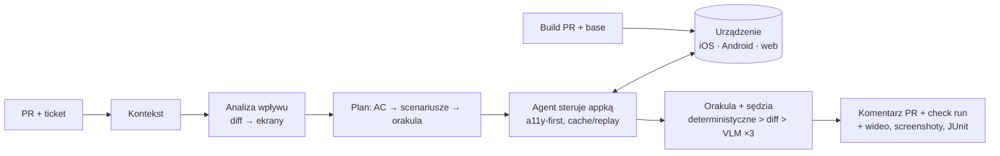

# Revlee

**Otwarty, self-hosted system agentowej weryfikacji pull requestów.** Agent AI czyta PR *i* powiązane zadanie (GitHub Issue / Jira / Linear), buduje jawny plan weryfikacji, uruchamia aplikację zbudowaną z PR-a na Twoim sprzęcie (iOS Simulator, Android Emulator, web), porównuje ją z gałęzią bazową i publikuje w GitHubie werdykt z dowodami: screenshotami, wideo, drzewami accessibility i tabelą „kryterium → dowód”.

Cel: system co najmniej równoważny [Revyl](https://revyl.com), działający na własnych runnerach GitHub Actions, w pełni open source, i lepszy tam, gdzie Revyl ma luki (kontekst ticketa, porównanie base vs PR, hierarchia orakli zamiast samego osądu VLM, check run, web, dowolne modele).

> Status: **dokumentacja projektowa** (faza koncepcji). Repozytorium zawiera pełną specyfikację systemu i notatki z researchu; kod powstanie według roadmapy w [docs/13](docs/13-roadmapa-i-ryzyka.md).

## Jak to działa w jednym obrazku

## Dokumentacja

| # | Rozdział | Treść |
|---|---|---|
| 01 | [Wizja i cele](docs/01-wizja-i-cele.md) | Problem, cele, zasady projektowe, zakres MVP vs docelowy |
| 02 | [Research i stan rynku](docs/02-research-i-stan-rynku.md) | Jak działa Revyl, co istnieje w OSS, klocki do użycia, gdzie można być lepszym |
| 03 | [Architektura](docs/03-architektura.md) | Komponenty, topologia, stos technologiczny, granice zaufania |
| 04 | [Przepływ PR → werdykt](docs/04-przeplyw-pr-do-werdyktu.md) | Sekwencja, fazy, maszyna stanów, werdykty, komendy `/verify` |
| 05 | [Kontekst PR-a i zadania](docs/05-kontekst-pr-i-zadania.md) | Źródła kontekstu, rozwiązywanie ticketów, ekstrakcja AC, `TaskContext`, sanityzacja |
| 06 | [Plan weryfikacji](docs/06-plan-weryfikacji.md) | Impact Analyzer, Planner, schemat `VerificationPlan`, walidacja planu |
| 07 | [Warstwa urządzeń i buildów](docs/07-warstwa-urzadzen-i-buildow.md) | Build Service, serwer MCP `revlee-device`, adaptery iOS/Android/web, evidence store |
| 08 | [Agent, orakula i sędzia](docs/08-agent-wykonawczy-i-orakula.md) | Pętla agenta, cache/replay, hierarchia orakli, sędzia odporny na fałszywe pass, base vs PR |
| 09 | [Raport i GitHub](docs/09-raport-i-integracja-github.md) | Układ komentarza, check run, media, `report.html`, komendy |
| 10 | [Bezpieczeństwo, koszty, limity](docs/10-bezpieczenstwo-koszty-limity.md) | Model zagrożeń, forki, hard controls, model kosztu |
| 11 | [Infrastruktura self-hosted](docs/11-infrastruktura-self-hosted.md) | Pule Mac (Tart/Cilicon) i Linux (ARC/KVM), cache, sieć, budżet czasu |
| 12 | [Konfiguracja, CLI, UX](docs/12-konfiguracja-cli-ux.md) | Pełny schemat `.revlee/config.yaml`, komendy CLI, MCP, workflow, doświadczenie developera |
| 13 | [Roadmapa i ryzyka](docs/13-roadmapa-i-ryzyka.md) | Fazy 0–3, metryki sukcesu, ryzyka, decyzje otwarte |
| 14 | [Decyzje (ADR) i źródła](docs/14-decyzje-i-zrodla.md) | Rejestr decyzji, słownik, bibliografia |

Przykłady: [`examples/workflows/`](examples/workflows/) (GitHub Actions dla zaufanych PR-ów i forków), [`examples/revlee/`](examples/revlee/) (`config.yaml`, `playbook.md`, `screens.yaml`, `ignore-regions.yaml`, `plan.example.json`), [`examples/pr-comment.md`](examples/pr-comment.md) (docelowy wygląd komentarza).

Research źródłowy (5 raportów, ~350 cytowań): [`research_notes/`](research_notes/Agentowa%20weryfikacja%20PR%20jak%20Revyl/).

## Najkrótsze streszczenie

1. **Nie istnieje** gotowy OSS, który robi pełną pętlę „ticket + diff → plan → aplikacja na urządzeniu → dowody w PR”. Istnieją dojrzałe klocki: `callstack/agent-device` (sterowanie iOS/Android a11y-first, dowody, replay `.ad`), Playwright, `tester-army/e2e` (cache kroków agenta), Claude Agent SDK / `claude-code-action` (agent w CI z gatingiem narzędzi), `odiff`, Tart/Cilicon i ARC (ephemeral runnery).
2. **Revyl** to vision-first agent w chmurze z werdyktem w komentarzu; nie czyta ticketów, nie porównuje z base, nie ustawia check runu, nie ma self-hosted ani web.
3. **Revlee** składa klocki w system z jawnym planem cytującym AC i hunki diffu, hierarchią orakli (deterministyczne asercje a11y → diff pikselowy base vs PR → sędzia VLM z głosowaniem i kontrolami negatywnymi), uczciwym stanem `unable_to_verify`, jednym idempotentnym komentarzem z mediami i check runem, pamięcią o aplikacji (App Map) i cache'em kroków obniżającym koszt kolejnych pushy.
4. Cele liczbowe: p50 ≤ 10 min, ≤ 2–3 USD na PR, ≤ 3–5 % fałszywych werdyktów na własnym benchu z wstrzykiwanymi błędami.
