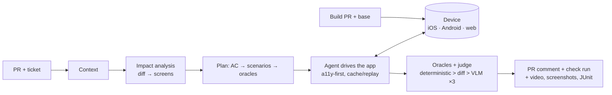

# Revlee

**An open, self-hosted system for agentic verification of pull requests.** An AI agent reads the PR *and* the linked task (GitHub Issue / Jira / Linear), builds an explicit verification plan, runs the application built from the PR on your own hardware (iOS Simulator, Android Emulator, web), compares it with the base branch, and publishes a verdict with evidence in GitHub: screenshots, video, accessibility trees, and a "criterion → evidence" table.

Goal: a system at least equivalent to [Revyl](https://revyl.com), running on your own GitHub Actions runners, fully open source, and better where Revyl has gaps (ticket context, base vs PR comparison, an oracle hierarchy instead of VLM judgment alone, check run, web, any models).

> Status: **design documentation plus a phase-0 spike**. The repository contains the full system specification, research notes, and a working minimal loop in [`spike/`](spike/); further code follows the roadmap in [docs/13](docs/13-roadmap-and-risks.md).

## How it works in one picture

## Documentation

| # | Chapter | Contents |
|---|---|---|
| 01 | [Vision and goals](docs/01-vision-and-goals.md) | Problem, goals, design principles, MVP vs target scope |
| 02 | [Research and market landscape](docs/02-research-and-landscape.md) | How Revyl works, what exists in OSS, building blocks to use, where we can be better |
| 03 | [Architecture](docs/03-architecture.md) | Components, topology, technology stack, trust boundaries |
| 04 | [Flow PR → verdict](docs/04-flow-pr-to-verdict.md) | Sequence, phases, state machine, verdicts, `/verify` commands |
| 05 | [PR and task context](docs/05-pr-and-task-context.md) | Context sources, ticket resolution, AC extraction, `TaskContext`, sanitization |
| 06 | [Verification plan](docs/06-verification-plan.md) | Impact Analyzer, Planner, `VerificationPlan` schema, plan validation |
| 07 | [Device and build layer](docs/07-device-and-build-layer.md) | Build Service, `revlee-device` MCP server, iOS/Android/web adapters, evidence store |
| 08 | [Agent, oracles, and judge](docs/08-executor-agent-and-oracles.md) | Agent loop, cache/replay, oracle hierarchy, a judge resistant to false passes, base vs PR |
| 09 | [Report and GitHub](docs/09-report-and-github-integration.md) | Comment layout, check run, media, `report.html`, commands |
| 10 | [Security, costs, limits](docs/10-security-costs-limits.md) | Threat model, forks, hard controls, cost model |
| 11 | [Self-hosted infrastructure](docs/11-self-hosted-infrastructure.md) | Mac (Tart/Cilicon) and Linux (ARC/KVM) pools, cache, network, time budget |
| 12 | [Configuration, CLI, UX](docs/12-configuration-cli-ux.md) | Full `.revlee/config.yaml` schema, CLI commands, MCP, workflow, developer experience |
| 13 | [Roadmap and risks](docs/13-roadmap-and-risks.md) | Phases 0–3, success metrics, risks, open decisions |
| 14 | [Decisions (ADR) and sources](docs/14-decisions-and-sources.md) | Decision register, glossary, bibliography |

Examples: [`examples/workflows/`](examples/workflows/) (GitHub Actions for trusted PRs and forks), [`examples/revlee/`](examples/revlee/) (`config.yaml`, `playbook.md`, `screens.yaml`, `ignore-regions.yaml`, `plan.example.json`), [`examples/pr-comment.md`](examples/pr-comment.md) (target look of the comment).

Source research (5 reports, ~350 citations): [`research_notes/`](research_notes/agentic-pr-verification-vs-revyl/).

## The shortest summary

1. **No** ready-made OSS exists that does the full loop "ticket + diff → plan → app on a device → evidence in the PR". Mature building blocks exist: `callstack/agent-device` (a11y-first iOS/Android control, evidence, `.ad` replay), Playwright, `tester-army/e2e` (agent step cache), Claude Agent SDK / `claude-code-action` (agent in CI with tool gating), `odiff`, Tart/Cilicon and ARC (ephemeral runners).
2. **Revyl** is a vision-first agent in the cloud with a verdict in a comment; it does not read tickets, does not compare with base, does not set a check run, has no self-hosted option and no web.
3. **Revlee** assembles the building blocks into a system with an explicit plan citing AC and diff hunks, an oracle hierarchy (deterministic a11y assertions → pixel diff base vs PR → VLM judge with voting and negative controls), an honest `unable_to_verify` state, a single idempotent comment with media and a check run, memory of the application (App Map), and a step cache that lowers the cost of subsequent pushes.
4. Numerical goals: p50 ≤ 10 min, ≤ 2–3 USD per PR, ≤ 3–5 % false verdicts on our own bench with injected bugs.

## Phase 0: spike

The [`spike/`](spike/) directory contains a working, minimal loop (plan → agent → replay on base → oracles → report) on Playwright/agent-device with a test application and a micro-benchmark of 4 variants. Result in model-less mode: 4/4 correct verdicts, ~12 s per run. Details and instructions for running with a model: [`spike/README.md`](spike/README.md).
