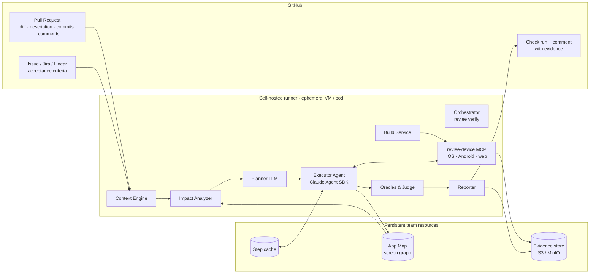
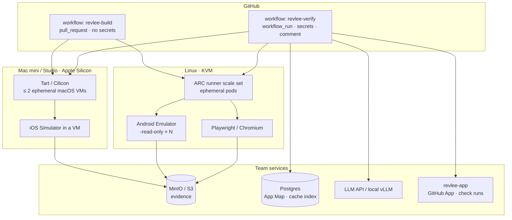
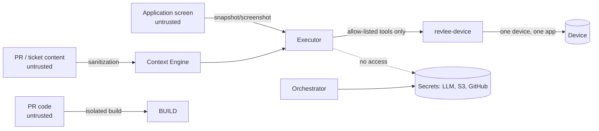

# 03 · Architecture

## 1. Bird's-eye view

One run (`run`) = one PR head SHA × one platform. Every run is fully reproducible from the evidence manifest (`evidence/manifest.json`).

## 2. Components

### 2.1 Orchestrator (`revlee verify`)

The entry point launched from GitHub Actions (or locally by a developer). It is responsible for:
- loading `.revlee/config.yaml` (the `security.*` and `budget.*` sections always from the base branch),
- the "whether to verify" decision (paths, labels, drafts, whether the change is user-visible),
- coordinating the phases: context → impact → plan → build → execution → judgment → report,
- enforcing budgets (USD, turns, minutes) and concurrency limits,
- the run state machine (see [04](04-flow-pr-to-verdict.md)) and writing the manifest.

Implementation: TypeScript (Node ≥ 22), package `@revlee/cli`. A single process, state in the directory `.revlee-run/<sha>/<platform>/`.

### 2.2 Context Engine

Collects and normalizes everything the agent is allowed to know about the task into a single `TaskContext` document (schema in [05](05-pr-and-task-context.md)):
- PR: title, the author-written part of the description (bot sections cut off), diff grouped by file, commits, list of changed files, the "Test plan" section from the PR template,
- ticket: link resolution (`Closes #N`, `PROJ-123`, Jira/Linear URL in the description, pattern in the branch name), fetching the description, acceptance criteria (custom field in Jira), subtasks, labels, image attachments,
- Figma (optional): PNG export of the specified frames,
- repo knowledge: `.revlee/playbook.md` (description of the application, key screens, test accounts), `.revlee/screens.yaml` (map of screens ↔ files/routes), App Map.

Adapters: `github`, `jira`, `linear`, `figma`. All read-only; tracker secrets never reach the agent (the adapter runs in the Orchestrator process, the agent sees only the already-processed text).

### 2.3 Impact Analyzer

Maps the diff to screens/flows before the LLM is invoked (grounding in the code, so the agent does not hallucinate paths):
1. **Statically:** changed files → import graph (TypeScript/Metro, Gradle modules, Swift targets) → screen registrations (React Navigation / Expo Router / Compose `NavHost` / SwiftUI views / Next.js routes) → screen identifiers. It also collects *anchors*: testID / accessibility labels / resource-id, i18n keys, feature flags, API endpoints.
2. **From the App Map:** for each screen, the path to reach it (sequence of transitions from the start screen), the most recent screenshots.
3. **Blast radius:** `local | shared_component | layout | global` (a change in a shared component or in a layout adds smoke scenarios on the top-N screens, like TurboSnap/Richter).
4. Output: `ImpactMap` (screens, anchors, blast radius, coverage by the App Map).

### 2.4 Planner

A single LLM call (model `models.planner`) with `TaskContext` + `ImpactMap` + `always_verify` → `VerificationPlan` (JSON schema, [06](06-verification-plan.md)):
- `claimed_behaviors[]` with source citations (diff hunk, ticket line),
- `scenarios[]` with steps in natural language, preconditions, oracles, a negative control, and the `compare_with_base` flag,
- `cannot_verify_via_ui[]` with reason codes,
- `coverage` – every acceptance criterion has ≥ 1 scenario or an explicit reason for its absence.

The plan is published in the report **before** execution (a table of steps, like TesterArmy), so the reviewer sees what will be checked.

### 2.5 Build Service

Builds artifacts once per SHA and platform (Debug/simulator `.app`, debuggable `.apk`, web bundle + server) in a separate job, publishes them as a short-retention artifact, stamps them with metadata (`head_sha`, `base_sha`, `pr_number`, `fingerprint`). For differential comparison it also builds (or fetches from cache) the base branch build. It reuses the native build for JS-only changes (Expo fingerprint). Details in [07](07-device-and-build-layer.md).

### 2.6 Device Layer (`revlee-device` MCP)

A single MCP server with a unified, platform-independent toolset, delegating to adapters:
- `ios` → agent-device (a11y bridge + XCTest) + `xcrun simctl` (boot, install, openurl, privacy, status_bar, recordVideo),
- `android` → agent-device (ADB + snapshot helper) + `adb`/`emulator` (snapshots, `-read-only`, `screenrecord`, `uiautomator dump`, `logcat`),
- `web` → Playwright (a11y snapshot, trace, video).

Tools for the agent: `observe` (a11y snapshot with refs + optional screenshot), `tap/press`, `type`, `type_secret`, `swipe/scroll`, `open_link`, `back/home`, `wait_stable`, `screenshot`, `assert_element` (deterministic assertion by role/name/testId), `read_logs`, `network_dump`. **System** tools, not available to the agent: device start/stop, installation, video recording, state snapshot. The server enforces: only the one device with the given ID, only the application under test in the foreground (otherwise `FOREGROUND_VIOLATION`), no screenshot after a secret has been typed (`PIXEL_TAINTED`, as in e2e), an allow-list of network hosts.

### 2.7 Executor Agent

An agentic loop (Claude Agent SDK, model `models.executor`) executing the scenarios from the plan:
- **a11y-first** perception: a text snapshot with refs; a screenshot is attached only when the snapshot does not describe the control, when the scenario has `vision: required` (colors, charts, canvas), or every N steps for evidence,
- before every action the agent records an **expectation** (`expect_after`); after the action it receives a snapshot diff; a mismatch is logged as an observation (the Cognition pattern),
- **step cache:** key = (scenario, step index, instruction, screen fingerprint, device profile); hit → execution without the model; miss → agent; "drift" → `handed_off`,
- limits: max turns, max steps per scenario, loop detection (3 identical screens), one "recovery" per scenario,
- all observations (snapshots, screenshots, actions, expectations) go to `evidence/`, and the agent's narrative goes to a separate file that **the Judge does not read**.

### 2.8 Oracles & Judge

Oracle hierarchy (from strongest), [08](08-executor-agent-and-oracles.md):
1. deterministic a11y/DOM assertion (`assert_element`),
2. deterministic state (log, network request, read-only read from the test backend),
3. differential base vs PR: a11y tree diff + `odiff` with dynamic regions ignored; the LLM only classifies the difference as intended/unintended relative to `change_intent`,
4. VLM judge with a rubric: receives screenshots/snapshots + the expected result, must point to the screenshot index and element as evidence; N = 3 samples (two model families), `pass` only when unanimous,
5. free-form judgment — can only downgrade to `inconclusive`, never grant `pass`.

Every scenario has a **negative control** (the old text does not appear; the base build does not show the new element). The aggregator computes the verdict per criterion and per run, as well as the confidence from the oracle type and the agreement of the votes (it does not ask the model for a number).

### 2.9 Reporter

Generates: one idempotent PR comment (AC table, step strip with thumbnails, video via `gh --attach`, a "not verified" section, JSON footer), a check run via the GitHub App (`neutral` by default, `failure` when `report.check_run.gating: failure`), `junit.xml`, `report.json`, a static `report.html`, and the write of observations to the App Map. Details in [09](09-report-and-github-integration.md).

### 2.10 App Map (the Atlas equivalent)

A database (SQLite in the artifact repo or Postgres in the team) with tables `screens` (a11y tree fingerprint, name, variant, area), `transitions` (action, from → to, time, run), `observations` (screenshot, snapshot, build, platform, run), `anchors` (testID/route → screen). Built incrementally from every run and from the `revlee map explore` command (BFS with a budget). Used by the Impact Analyzer (path to reach a screen), the Executor (navigation hints, cache), and the Reporter (comparison with previous observations of that screen).

## 3. Deployment topology

- **Trusted PRs (from the same repo):** a single `pull_request` workflow builds and verifies on an ephemeral runner (VM/pod per job), with access to the LLM and S3 secrets.
- **PRs from forks:** `pull_request` builds without secrets and publishes the artifact; verification starts only after `/verify` from a person with write access, in a `workflow_run` on the base branch with the fork's artifact as input (the fork's code never executes with secrets).
- **Device queue:** limit of 2 macOS VMs per host; Android/web scale through ARC. The Orchestrator respects `concurrency: verify-${pr}` with `cancel-in-progress`.

## 4. Technology stack and rationale

| Layer | Choice | Why |
|---|---|---|
| Language | TypeScript / Node 22 | Ecosystem of agent-device, Playwright, e2e, MCP SDK, Claude Agent SDK |
| Agent runtime | Claude Agent SDK (`@anthropic-ai/claude-agent-sdk`) | `PreToolUse` hooks, `allowedTools`, budgets, in-process MCP; alternatively our own loop on the Messages API through an adapter |
| Models | planner/judge: Claude Sonnet 5.5 / Opus 5.5; executor: Sonnet 5.5 or Haiku 5.5; second judge: GPT-5.4; grounding optionally local (UI-TARS-1.5-7B) | Role separation lowers cost; two model families in voting |
| Mobile | agent-device | The most mature OSS a11y-first driver with evidence; MIT |
| Web | Playwright | trace.zip, a11y snapshot, the standard |
| Image diff | odiff (fallback pixelmatch) | speed, anti-aliasing, ignore regions |
| Data | SQLite (MVP) → Postgres | App Map and cache index |
| Evidence | local directory → Actions artifacts + S3/MinIO | artifacts require login; S3 provides public links to the trace viewer |
| GitHub | `gh` ≥ 2.99 (`--attach`), GitHub App (Checks API) | media in the comment; check runs require an App |
| CI | GitHub Actions self-hosted (Tart/Cilicon on Mac, ARC on Linux) | user requirement |

## 5. Trust boundaries

The agent never has: a shell, write access to the repo, a GitHub token, an S3 key, access to devices other than the assigned one. Secrets are held by the Orchestrator and the MCP server. Full threat model in [10](10-security-costs-limits.md).
