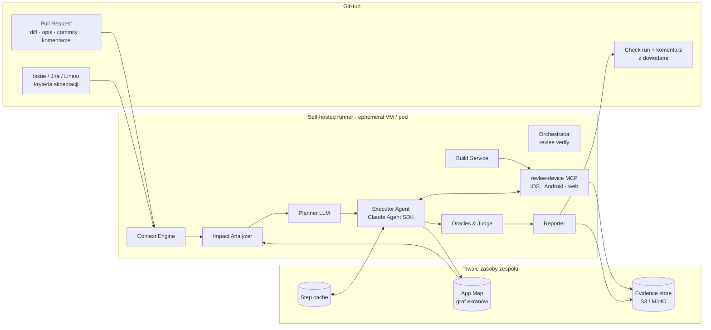
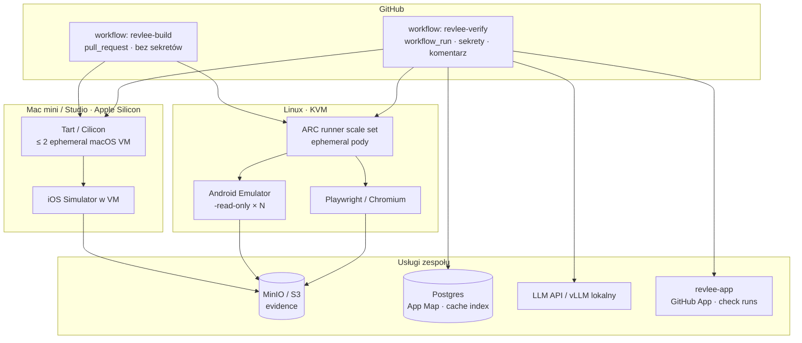
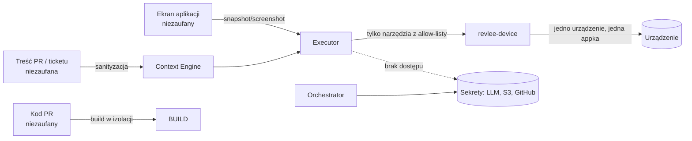

# 03 · Architektura

## 1. Widok z lotu ptaka

Jedno uruchomienie (`run`) = jeden PR head SHA × jedna platforma. Każdy run jest w pełni odtwarzalny z manifestu dowodów (`evidence/manifest.json`).

## 2. Komponenty

### 2.1 Orchestrator (`revlee verify`)

Punkt wejścia uruchamiany z GitHub Actions (lub lokalnie przez developera). Odpowiada za:
- wczytanie `.revlee/config.yaml` (sekcje `security.*` i `budget.*` zawsze z gałęzi bazowej),
- decyzję „czy weryfikować” (ścieżki, etykiety, drafty, czy zmiana jest user-visible),
- koordynację faz: kontekst → wpływ → plan → build → wykonanie → osąd → raport,
- egzekwowanie budżetów (USD, tury, minuty) i limitów równoległości,
- stan maszyny runu (patrz [04](04-przeplyw-pr-do-werdyktu.md)) i zapis manifestu.

Implementacja: TypeScript (Node ≥ 22), pakiet `@revlee/cli`. Jeden proces, stan w katalogu `.revlee-run/<sha>/<platform>/`.

### 2.2 Context Engine

Zbiera i normalizuje wszystko, co agent ma prawo wiedzieć o zadaniu, do jednego dokumentu `TaskContext` (schemat w [05](05-kontekst-pr-i-zadania.md)):
- PR: tytuł, autorska część opisu (odcięte sekcje botów), diff pogrupowany po plikach, commity, lista zmienionych plików, sekcja „Test plan” z szablonu PR,
- ticket: rozwiązywanie linków (`Closes #N`, `PROJ-123`, URL Jira/Linear w opisie, wzorzec w nazwie gałęzi), pobranie opisu, kryteriów akceptacji (pole custom w Jira), podzadań, etykiet, załączników obrazkowych,
- Figma (opcjonalnie): eksport PNG wskazanych frame'ów,
- repo knowledge: `.revlee/playbook.md` (opis aplikacji, kluczowe ekrany, konta testowe), `.revlee/screens.yaml` (mapa ekranów ↔ pliki/route'y), App Map.

Adaptery: `github`, `jira`, `linear`, `figma`. Wszystkie read-only; sekrety trackerów nigdy nie trafiają do agenta (adapter działa w procesie Orchestratora, agent widzi już przetworzony tekst).

### 2.3 Impact Analyzer

Mapuje diff na ekrany/przepływy, zanim odezwie się LLM (ugruntowanie w kodzie, by agent nie halucynował ścieżek):
1. **Statycznie:** zmienione pliki → graf importów (TypeScript/Metro, Gradle moduły, Swift targets) → rejestracje ekranów (React Navigation / Expo Router / Compose `NavHost` / SwiftUI views / Next.js routes) → identyfikatory ekranów. Zbiera też *kotwice*: testID / accessibility labels / resource-id, klucze i18n, flagi funkcji, endpointy API.
2. **Z App Map:** dla każdego ekranu ścieżka dojścia (sekwencja przejść od ekranu startowego), ostatnie screenshoty.
3. **Promień zmiany:** `local | shared_component | layout | global` (zmiana w komponencie współdzielonym lub w layoucie dodaje scenariusze smoke na top-N ekranach, jak TurboSnap/Richter).
4. Wyjście: `ImpactMap` (ekrany, kotwice, promień, pokrycie przez App Map).

### 2.4 Planner

Jedno wywołanie LLM (model `models.planner`) z `TaskContext` + `ImpactMap` + `always_verify` → `VerificationPlan` (JSON schema, [06](06-plan-weryfikacji.md)):
- `claimed_behaviors[]` z cytowaniem źródła (hunk diffu, linia ticketa),
- `scenarios[]` z krokami w języku naturalnym, prekondycjami, oraklami, kontrolą negatywną i flagą `compare_with_base`,
- `cannot_verify_via_ui[]` z kodami przyczyn,
- `coverage` – każde kryterium akceptacji ma ≥ 1 scenariusz lub jawny powód braku.

Plan jest publikowany w raporcie **przed** wykonaniem (tabela kroków, jak TesterArmy), więc recenzent widzi, co będzie sprawdzane.

### 2.5 Build Service

Buduje artefakty raz na SHA i platformę (Debug/simulator `.app`, debuggable `.apk`, web bundle + serwer) w osobnym jobie, publikuje jako artefakt o krótkiej retencji, stempluje metadanymi (`head_sha`, `base_sha`, `pr_number`, `fingerprint`). Dla porównania różnicowego buduje też (lub pobiera z cache) build gałęzi bazowej. Reużywa natywny build przy zmianach tylko JS (Expo fingerprint). Szczegóły w [07](07-warstwa-urzadzen-i-buildow.md).

### 2.6 Device Layer (`revlee-device` MCP)

Jeden serwer MCP z ujednoliconym zestawem narzędzi niezależnym od platformy, delegujący do adapterów:
- `ios` → agent-device (bridge a11y + XCTest) + `xcrun simctl` (boot, install, openurl, privacy, status_bar, recordVideo),
- `android` → agent-device (ADB + snapshot helper) + `adb`/`emulator` (snapshoty, `-read-only`, `screenrecord`, `uiautomator dump`, `logcat`),
- `web` → Playwright (snapshot a11y, trace, wideo).

Narzędzia dla agenta: `observe` (snapshot a11y z refami + opcjonalny screenshot), `tap/press`, `type`, `type_secret`, `swipe/scroll`, `open_link`, `back/home`, `wait_stable`, `screenshot`, `assert_element` (deterministyczna asercja po roli/nazwie/testId), `read_logs`, `network_dump`. Narzędzia **systemowe**, niedostępne dla agenta: start/stop urządzenia, instalacja, nagrywanie wideo, snapshot stanu. Serwer wymusza: tylko jedno urządzenie o podanym ID, tylko aplikacja pod testem na pierwszym planie (inaczej `FOREGROUND_VIOLATION`), brak screenshotu po wpisaniu sekretu (`PIXEL_TAINTED`, jak w e2e), allow-lista hostów sieciowych.

### 2.7 Executor Agent

Pętla agentowa (Claude Agent SDK, model `models.executor`) wykonująca scenariusze z planu:
- percepcja **a11y-first**: snapshot tekstowy z refami; screenshot dołączany tylko gdy snapshot nie opisuje kontrolki, gdy scenariusz ma `vision: required` (kolory, wykresy, canvas) lub co N kroków do dowodu,
- przed każdą akcją agent zapisuje **oczekiwanie** (`expect_after`), po akcji dostaje diff snapshotu; niezgodność jest logowana jako obserwacja (wzorzec Cognition),
- **cache kroków:** klucz = (scenariusz, indeks kroku, instrukcja, fingerprint ekranu, profil urządzenia); trafienie → wykonanie bez modelu; chybienie → agent; „drift” → `handed_off`,
- limity: max tur, max kroków na scenariusz, detekcja pętli (3 identyczne ekrany), jeden „recovery” na scenariusz,
- wszystkie obserwacje (snapshoty, screenshoty, akcje, oczekiwania) trafiają do `evidence/`, a narracja agenta do osobnego pliku, którego **sędzia nie czyta**.

### 2.8 Oracles & Judge

Hierarchia orakli (od najsilniejszego), [08](08-agent-wykonawczy-i-orakula.md):
1. deterministyczna asercja a11y/DOM (`assert_element`),
2. deterministyczny stan (log, żądanie sieciowe, odczyt read-only z backendu testowego),
3. różnicowa base vs PR: diff drzew a11y + `odiff` z ignorowaniem regionów dynamicznych; LLM tylko klasyfikuje różnicę jako zamierzoną/niezamierzoną względem `change_intent`,
4. sędzia VLM z rubryką: dostaje screenshoty/snapshoty + oczekiwany wynik, musi wskazać indeks screenshotu i element jako dowód; N = 3 próbki (dwie rodziny modeli), `pass` tylko przy jednomyślności,
5. swobodny osąd — może jedynie obniżyć do `inconclusive`, nigdy dać `pass`.

Każdy scenariusz ma **kontrolę negatywną** (stary tekst nie występuje; build bazowy nie pokazuje nowego elementu). Agregator wylicza werdykt per kryterium i per run oraz pewność z typu orakla i zgodności głosów (nie pyta modelu o liczbę).

### 2.9 Reporter

Generuje: jeden idempotentny komentarz PR (tabela AC, pasek kroków z miniaturami, wideo przez `gh --attach`, sekcja „nie zweryfikowano”, stopka JSON), check run przez GitHub App (`neutral` domyślnie, `failure` gdy `report.check_run.gating: failure`), `junit.xml`, `report.json`, statyczny `report.html`, oraz zapis obserwacji do App Map. Szczegóły w [09](09-raport-i-integracja-github.md).

### 2.10 App Map (odpowiednik Atlas)

Baza (SQLite w repo artefaktów lub Postgres w zespole) z tabelami `screens` (fingerprint drzewa a11y, nazwa, wariant, obszar), `transitions` (akcja, z → do, czas, run), `observations` (screenshot, snapshot, build, platforma, run), `anchors` (testID/route → screen). Budowana przyrostowo z każdego runu i z komendy `revlee map explore` (BFS z budżetem). Używana przez Impact Analyzer (ścieżka dojścia do ekranu), Executor (podpowiedź nawigacji, cache) i Reporter (porównanie z poprzednimi obserwacjami tego ekranu).

## 3. Topologia wdrożenia

- **Zaufane PR-y (z tego samego repo):** jeden workflow `pull_request` buduje i weryfikuje na ephemeral runnerze (VM/pod per job), z dostępem do sekretów LLM i S3.
- **PR-y z forków:** `pull_request` buduje bez sekretów i publikuje artefakt; weryfikacja startuje tylko po `/verify` od osoby z write access, w `workflow_run` na gałęzi bazowej z artefaktem forka jako wejściem (kod forka nigdy nie wykonuje się z sekretami).
- **Kolejka urządzeń:** limit 2 VM macOS na hoście; Android/web skalują się przez ARC. Orchestrator respektuje `concurrency: verify-${pr}` z `cancel-in-progress`.

## 4. Stos technologiczny i uzasadnienie

| Warstwa | Wybór | Dlaczego |
|---|---|---|
| Język | TypeScript / Node 22 | Ekosystem agent-device, Playwright, e2e, MCP SDK, Claude Agent SDK |
| Agent runtime | Claude Agent SDK (`@anthropic-ai/claude-agent-sdk`) | Hooki `PreToolUse`, `allowedTools`, budżety, MCP w procesie; alternatywnie własna pętla na Messages API przez adapter |
| Modele | planner/judge: Claude Sonnet 5.5 / Opus 5.5; executor: Sonnet 5.5 lub Haiku 5.5; drugi sędzia: GPT-5.4; grounding opcjonalnie lokalny (UI-TARS-1.5-7B) | Separacja ról obniża koszt; dwie rodziny modeli w głosowaniu |
| Mobile | agent-device | Najdojrzalszy OSS sterownik a11y-first z dowodami; MIT |
| Web | Playwright | trace.zip, a11y snapshot, standard |
| Diff obrazów | odiff (fallback pixelmatch) | szybkość, anti-aliasing, ignore regions |
| Dane | SQLite (MVP) → Postgres | App Map i indeks cache |
| Dowody | katalog lokalny → artefakty Actions + S3/MinIO | artefakty wymagają logowania; S3 daje publiczne linki do trace viewera |
| GitHub | `gh` ≥ 2.99 (`--attach`), GitHub App (Checks API) | media w komentarzu; check runs wymagają App |
| CI | GitHub Actions self-hosted (Tart/Cilicon na Macu, ARC na Linuxie) | wymaganie użytkownika |

## 5. Granice zaufania

Agent nigdy nie ma: shell'a, zapisu do repo, tokenu GitHub, klucza S3, dostępu do innych urządzeń niż przypisane. Sekrety trzyma Orchestrator i serwer MCP. Pełny model zagrożeń w [10](10-bezpieczenstwo-koszty-limity.md).
