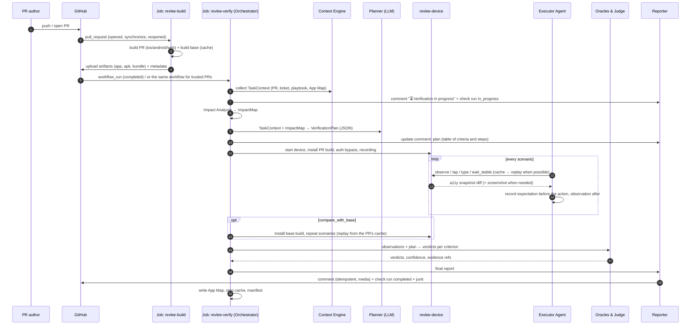
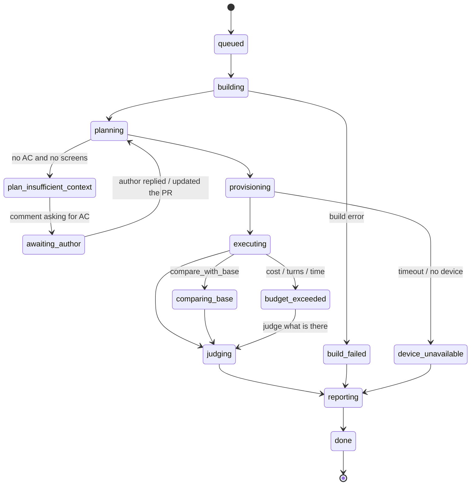

# 04 · Flow: from PR to verdict

## 1. Sequence diagram

## 2. Phases and contracts

| Phase | Input | Output | Time limit (target) |
|---|---|---|---|
| 0. Trigger & gate | GitHub event, `.revlee/config.yaml` | decision `run \| skip(reason)` | 5 s |
| 1. Build | head SHA, base SHA | artifacts + `build.json` | 2–6 min (warm cache) |
| 2. Context | PR, ticket, repo | `TaskContext` | 10–30 s |
| 3. Impact | diff, repo, App Map | `ImpactMap` | 10–60 s |
| 4. Plan | TaskContext, ImpactMap | `VerificationPlan` | 20–60 s (1 LLM call) |
| 5. Device ready | artifact | device session, recording | 20 s–3 min |
| 6. Execute | plan, session | `observations[]`, `evidence/` | 1–6 min |
| 7. Base compare | plan, base build | `observations_base[]` | 1–3 min (optional) |
| 8. Judge | observations, plan | `verdicts[]` | 20–60 s |
| 9. Report | verdicts, evidence | comment, check run, junit, html | 10–30 s |
| 10. Persist | observations | App Map, step cache | 5 s |

Overall target: p50 ≤ 10 min. Phase 1 is the largest variable; see [07](07-device-and-build-layer.md) and [11](11-self-hosted-infrastructure.md).

## 3. Phase 0: whether to verify at all

The Orchestrator skips the run (`skip`) and publishes a **neutral** one-line comment when:

| Condition | `skip_reason` code |
|---|---|
| Draft PR and `triggers.drafts: false` | `draft` |
| No changed file matches `triggers.paths` | `paths_not_matched` |
| Excluding label (e.g. `skip-verify`) | `label_excluded` |
| The diff touches only non-UI files (tests, CI, docs, lockfile), the Impact Analyzer found no screen, and the ticket has no user-facing AC | `no_user_visible_change` |
| PR from a fork without `/verify` from a person with write access | `fork_requires_manual_trigger` |
| Daily repo budget exhausted (`budget.daily_max_usd`) | `budget_exhausted` |

Commands in PR comments (only from `OWNER|MEMBER|COLLABORATOR`):

| Command | Action |
|---|---|
| `/verify` | force a run (also for forks and drafts) |
| `/verify again` | repeat on the same SHA, ignoring the step cache |
| `/verify "only the cart screen"` | restrict the plan to the given scope (the text goes to the Planner as `scope_hint`) |
| `/verify ios` / `/verify android` / `/verify web` | only the specified platform |
| `/verify explore` | exploratory mode without an AC-based plan (BFS over the affected screens) |
| `/verify stop` | abort the current run, release the device |

## 4. Run state machine

Every state is visible in the PR comment (header) and in the check run (`in_progress` → `completed`). A new push to the PR (`synchronize`) cancels the run in progress (`concurrency.cancel-in-progress`) and starts a new one; the previous run's evidence remains in the artifacts.

## 5. Run verdict

The run verdict is **a function of the criterion verdicts**, not a judgment by the model:

| Run verdict | Rule |
|---|---|
| `ready` | all criteria `pass`, negative controls `pass`, no `fail` in `always_verify` |
| `ready_with_issues` | all criteria from the ticket `pass`, but ≥ 1 regression on a screen outside the PR's scope (differential) or `always_verify` with `inconclusive` |
| `failed` | ≥ 1 criterion `fail` confirmed by a deterministic oracle or a unanimous judge, or an application crash/ANR |
| `inconclusive` | no `fail`, but ≥ 1 criterion `inconclusive` (judges disagree, unresolved drift) |
| `unable_to_verify` | no criterion was executed (build, device, auth, budget) |
| `not_applicable` | skip from phase 0 |

Mapping to the check run: `ready` → `success`; `ready_with_issues`/`inconclusive` → `neutral` (or `action_required` when `gating: strict`); `failed` → `failure` when `gating: failure`, otherwise `neutral` with a red header; `unable_to_verify`/`not_applicable` → `neutral`. Run confidence = min of the criterion confidences.

## 6. Handling missing context

If the Planner finds **no** acceptance criteria at all (no ticket, empty PR description, no "Test plan" section) **and** the Impact Analyzer identified screens:

1. The Planner creates scenarios **derived from the diff** (`source: diff_inference`) and marks them in the report as "no AC: checking that the changed screens work and that the change from the diff is visible".
2. The Reporter appends a block to the comment with a question to the author: "I found no acceptance criteria. Add an `## Acceptance criteria` section to the PR description or link a ticket, and I will run a full verification (`/verify`)."
3. The run verdict cannot be higher than `ready_with_issues` (no confirmation of intent).

If there are neither AC nor screens: `plan_insufficient_context` → neutral comment, no device usage.

## 7. Repeated pushes on the same PR

- The plan is regenerated, but the Planner receives the previous plan and the list of files changed since the last run, so it stabilizes scenario identifiers (the same `scenario_id` for the same AC).
- Steps of scenarios whose screens are **not** in the new diff's `ImpactMap` replay from the cache without the model (as in e2e: target by role/name/testId, end-state check). Steps affected by the diff are executed by the agent.
- The comment is overwritten (one per PR); previous runs are available through a "run history" link to the artifacts/S3.
- Open `findings` from previous runs are passed to the Planner as "to be re-checked"; they close automatically when the negative control passes.

## 8. Example: from ticket to verdict in 9 minutes

1. Ticket `SHOP-412`: "The *Add to cart* button should be green and, after a tap, show a toast with the product name". AC: (a) button color #1DB954, (b) toast "Added: {name}" disappears after 3 s, (c) cart counter +1.
2. PR #88 changes `ProductScreen.tsx`, `theme.ts`, adds `Toast.tsx`. Description: "Closes SHOP-412".
3. Android build 3 min 10 s (Gradle cache), base from cache.
4. Impact: `ProductScreen` (local), `theme.ts` → `shared_component` → smoke on Home, Cart, Profile.
5. Plan: 3 criteria → 3 scenarios + 3 smoke; AC (a) marked `vision: required`; negative control: "on the base build the button is not green, no toast".
6. Executor: 14 steps by the agent, 9 steps from the cache (navigation to the product known from the App Map), 1 min 50 s.
7. Base compare: the same steps replayed, 1 min 05 s.
8. Judge: (a) `pass` (odiff: the button changed color; 3/3 judges: green; base: blue), (b) `pass` (a11y assertion on the toast text + `wait_stable` after 3 s: absent), (c) `pass` (a11y assertion on the counter "1"). Smoke: no differences beyond the intended ones.
9. Report: `ready`, confidence 0.92, cost 1.80 USD, 8 min 40 s. Check run `success`.
