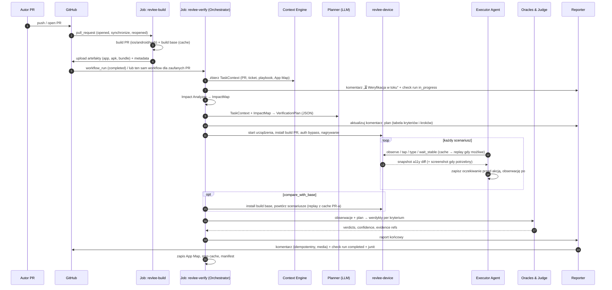
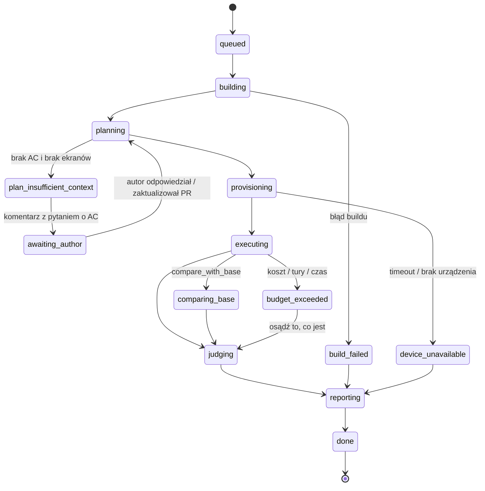

# 04 · Przepływ: od PR-a do werdyktu

## 1. Diagram sekwencji

## 2. Fazy i kontrakty

| Faza | Wejście | Wyjście | Limit czasu (cel) |
|---|---|---|---|
| 0. Trigger & gate | event GitHub, `.revlee/config.yaml` | decyzja `run \| skip(reason)` | 5 s |
| 1. Build | SHA head, SHA base | artefakty + `build.json` | 2–6 min (ciepły cache) |
| 2. Context | PR, ticket, repo | `TaskContext` | 10–30 s |
| 3. Impact | diff, repo, App Map | `ImpactMap` | 10–60 s |
| 4. Plan | TaskContext, ImpactMap | `VerificationPlan` | 20–60 s (1 wywołanie LLM) |
| 5. Device ready | artefakt | sesja urządzenia, nagrywanie | 20 s–3 min |
| 6. Execute | plan, sesja | `observations[]`, `evidence/` | 1–6 min |
| 7. Base compare | plan, build base | `observations_base[]` | 1–3 min (opcjonalnie) |
| 8. Judge | obserwacje, plan | `verdicts[]` | 20–60 s |
| 9. Report | verdicts, evidence | komentarz, check run, junit, html | 10–30 s |
| 10. Persist | obserwacje | App Map, step cache | 5 s |

Cel całości: p50 ≤ 10 min. Faza 1 jest największą zmienną; patrz [07](07-warstwa-urzadzen-i-buildow.md) i [11](11-infrastruktura-self-hosted.md).

## 3. Faza 0: czy w ogóle weryfikować

Orchestrator pomija run (`skip`) i publikuje **neutralny** komentarz jednolinijkowy, gdy:

| Warunek | Kod `skip_reason` |
|---|---|
| Draft PR, a `triggers.drafts: false` | `draft` |
| Żaden zmieniony plik nie pasuje do `triggers.paths` | `paths_not_matched` |
| Etykieta wykluczająca (np. `skip-verify`) | `label_excluded` |
| Diff dotyczy tylko plików nie-UI (testy, CI, docs, lockfile) i Impact Analyzer nie znalazł żadnego ekranu, a ticket nie ma AC użytkownika | `no_user_visible_change` |
| PR z forka bez `/verify` od osoby z write access | `fork_requires_manual_trigger` |
| Budżet dzienny repo wyczerpany (`budget.daily_max_usd`) | `budget_exhausted` |

Komendy w komentarzach PR (tylko od `OWNER|MEMBER|COLLABORATOR`):

| Komenda | Działanie |
|---|---|
| `/verify` | wymuś run (także dla forków i draftów) |
| `/verify again` | powtórz na tym samym SHA, ignorując cache kroków |
| `/verify "tylko ekran koszyka"` | ogranicz plan do podanego zakresu (tekst trafia do Plannera jako `scope_hint`) |
| `/verify ios` / `/verify android` / `/verify web` | tylko wskazana platforma |
| `/verify explore` | tryb eksploracyjny bez planu z AC (BFS po dotkniętych ekranach) |
| `/verify stop` | przerwij bieżący run, zwolnij urządzenie |

## 4. Maszyna stanów runu

Każdy stan jest widoczny w komentarzu PR (nagłówek) i w check runie (`in_progress` → `completed`). Nowy push na PR (`synchronize`) anuluje run w toku (`concurrency.cancel-in-progress`) i startuje nowy; dowody poprzedniego runu zostają w artefaktach.

## 5. Werdykt runu

Werdykt runu jest **funkcją werdyktów kryteriów**, nie osądem modelu:

| Werdykt runu | Reguła |
|---|---|
| `ready` | wszystkie kryteria `pass`, kontrole negatywne `pass`, brak `fail` w `always_verify` |
| `ready_with_issues` | wszystkie kryteria z ticketa `pass`, ale ≥ 1 regresja na ekranie poza zakresem PR (różnicowa) lub `always_verify` z `inconclusive` |
| `failed` | ≥ 1 kryterium `fail` potwierdzone oraklem deterministycznym lub jednomyślnym sędzią, albo crash/ANR aplikacji |
| `inconclusive` | brak `fail`, ale ≥ 1 kryterium `inconclusive` (sędziowie niezgodni, drift nierozwiązany) |
| `unable_to_verify` | żadne kryterium nie zostało wykonane (build, urządzenie, auth, budżet) |
| `not_applicable` | skip z fazy 0 |

Mapowanie na check run: `ready` → `success`; `ready_with_issues`/`inconclusive` → `neutral` (lub `action_required` gdy `gating: strict`); `failed` → `failure` gdy `gating: failure`, inaczej `neutral` z czerwonym nagłówkiem; `unable_to_verify`/`not_applicable` → `neutral`. Pewność runu = min pewności kryteriów.

## 6. Obsługa braku kontekstu

Jeżeli Planner nie znajdzie **żadnego** kryterium akceptacji (brak ticketa, pusty opis PR, brak sekcji „Test plan”) **i** Impact Analyzer wskazał ekrany:

1. Planner tworzy scenariusze **wyprowadzone z diffu** (`source: diff_inference`) i oznacza je w raporcie jako „bez AC: sprawdzam, że zmienione ekrany działają i że zmiana z diffu jest widoczna”.
2. Reporter dopisuje do komentarza blok z pytaniem do autora: „Nie znalazłem kryteriów akceptacji. Dodaj do opisu PR sekcję `## Acceptance criteria` lub podlinkuj ticket, a uruchomię pełną weryfikację (`/verify`).”
3. Werdykt runu nie może być wyższy niż `ready_with_issues` (brak potwierdzenia intencji).

Jeżeli ani AC, ani ekranów: `plan_insufficient_context` → komentarz neutralny, brak zużycia urządzenia.

## 7. Ponowne pushe na tym samym PR-ze

- Plan jest regenerowany, ale Planner dostaje poprzedni plan i listę zmienionych plików od ostatniego runu, więc stabilizuje identyfikatory scenariuszy (ten sam `scenario_id` dla tego samego AC).
- Kroki scenariuszy, których ekrany **nie** są w `ImpactMap` nowego diffu, replayują się z cache bez modelu (jak w e2e: cel po roli/nazwie/testId, kontrola stanu końcowego). Kroki dotknięte diffem są wykonywane agentem.
- Komentarz jest nadpisywany (jeden na PR), poprzednie runy dostępne przez link „historia runów” do artefaktów/S3.
- Otwarte ustalenia (`findings`) z poprzednich runów są przekazywane do Plannera jako „do ponownego sprawdzenia”; zamykają się automatycznie, gdy kontrola negatywna przejdzie.

## 8. Przykład: od ticketa do werdyktu w 9 minut

1. Ticket `SHOP-412`: „Przycisk *Dodaj do koszyka* ma być zielony i po tapnięciu pokazać toast z nazwą produktu”. AC: (a) kolor przycisku #1DB954, (b) toast „Dodano: {nazwa}” znika po 3 s, (c) licznik koszyka +1.
2. PR #88 zmienia `ProductScreen.tsx`, `theme.ts`, dodaje `Toast.tsx`. Opis: „Closes SHOP-412”.
3. Build Android 3 min 10 s (cache Gradle), base z cache.
4. Impact: `ProductScreen` (local), `theme.ts` → `shared_component` → smoke na Home, Cart, Profile.
5. Plan: 3 kryteria → 3 scenariusze + 3 smoke; AC (a) oznaczone `vision: required`; kontrola negatywna: „na buildzie base przycisk nie jest zielony, brak toasta”.
6. Executor: 14 kroków agentem, 9 kroków z cache (nawigacja do produktu znana z App Map), 1 min 50 s.
7. Base compare: te same kroki replay, 1 min 05 s.
8. Judge: (a) `pass` (odiff: przycisk zmienił kolor; 3/3 sędziów: zielony; base: niebieski), (b) `pass` (asercja a11y na tekst toasta + `wait_stable` po 3 s: brak), (c) `pass` (asercja a11y licznika „1”). Smoke: brak różnic poza zamierzonymi.
9. Raport: `ready`, pewność 0,92, koszt 1,80 USD, 8 min 40 s. Check run `success`.
