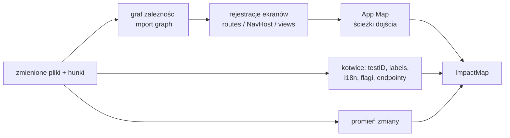

# 06 · Plan weryfikacji: analiza wpływu i generowanie scenariuszy

Plan jest sercem różnicy między Revlee i „agent, który klika, aż mu się znudzi”. Jest **jawny, cytowany i publikowany przed wykonaniem**.

## 1. Impact Analyzer (deterministyczny, przed LLM)

### 1.1 Wejście → wyjście



### 1.2 Wykrywanie ekranów per stos

| Stos | Rejestracje ekranów | Narzędzie |
|---|---|---|
| React Native / Expo | `createNativeStackNavigator` `Screen name=…`, pliki `app/**/*.tsx` (Expo Router) | parser TS (ts-morph) + graf importów (madge/Metro `--dependency-graph`) |
| Next.js / web | `app/**/page.tsx`, `pages/**`, `routes.ts` | parser plików + import graph |
| Android (Kotlin) | `NavHost { composable("…") }`, `Activity`/`Fragment` w manifeście, `nav_graph.xml` | kotlin-analysis lite / regex + Gradle module graph |
| iOS (Swift) | `NavigationStack`, `.navigationDestination`, storyboardy, `UIViewController` | SourceKitten / regex + target graph |
| Flutter | `GoRouter` routes, `Navigator.pushNamed` | Dart analyzer |

Plik `.revlee/screens.yaml` nadpisuje/uzupełnia wykrycie. Gdy stosu nie da się sparsować: fallback = zmienione pliki → LLM proponuje ekrany (oznaczone `confidence: low`).

### 1.3 Promień zmiany

| `blast_radius` | Warunek | Skutek w planie |
|---|---|---|
| `local` | zmiany tylko w plikach przypisanych do ≤ 2 ekranów | scenariusze tylko dla tych ekranów |
| `shared_component` | zmiana w `shared.files` (theme, komponenty UI, hooki) | + smoke na `smoke_screens` (porównanie różnicowe base vs PR, bez AC) |
| `layout` | nawigacja, layout root, tab bar | + smoke na wszystkich ekranach z App Map o `heat ≥ p50` (limit 8) |
| `global` | zależności natywne, build config, i18n root, flagi | + smoke launch + 5 najczęstszych ekranów; plan oznacza `coverage: partial` |
| `none` | tylko testy/CI/docs | `skip: no_user_visible_change` (chyba że AC mówią inaczej) |

### 1.4 Schemat `ImpactMap`

```json
{
  "schema": "revlee.impact_map/1",
  "screens": [
    { "id": "product", "confidence": 0.95, "why": ["src/screens/ProductScreen.tsx modified (h1)"], "entry_path": ["home", "tap:tab Products", "tap:first product card"], "last_observation": "obs_9f3", "anchors": { "test_ids": ["add-to-cart", "cart-badge"], "i18n_keys": ["cart.added"] } },
    { "id": "home", "confidence": 0.6, "why": ["theme.ts shared_component"], "entry_path": [], "smoke_only": true }
  ],
  "blast_radius": "shared_component",
  "unmapped_files": ["src/utils/format.ts"],
  "feature_flags": [{ "name": "newToast", "default": true, "source": "src/flags.ts" }],
  "api_endpoints_touched": [],
  "coverage": { "mapped_hunks": 3, "total_hunks": 3 }
}
```

## 2. Planner (LLM)

### 2.1 Kontrakt

Jedno wywołanie modelu `models.planner` z wymuszonym schematem JSON. Wejście: `TaskContext`, `ImpactMap`, `always_verify[]`, `scope_hint`, poprzedni plan (jeśli jest). Wyjście: `VerificationPlan`.

Twarde reguły promptu systemowego (streszczenie; pełny prompt w `packages/planner/prompts/plan.md`):

1. Każde `claimed_behavior` musi mieć `source_ref` do AC ticketa, hunka diffu lub linii opisu PR. Bez źródła → nie wolno go dodać.
2. Każde AC → ≥ 1 scenariusz, albo wpis w `cannot_verify_via_ui` z kodem.
3. Scenariusz = prekondycje + ≤ 12 kroków w języku naturalnym, niezależnych od platformy („tapnij przycisk *Dodaj do koszyka*”, nie „kliknij @e12”) + ≥ 1 orakulum + 1 kontrola negatywna.
4. Orakula wybieraj od najsilniejszego: `a11y_assert` → `state_assert` → `visual_diff_vs_base` → `vlm_rubric`. `vlm_rubric` tylko dla cech niewidocznych w drzewie a11y (kolor, układ, wykres, animacja).
5. Zaznacz `expected_on_base: same|different|absent` dla każdego orakulum (umożliwia porównanie różnicowe).
6. Zakaz działań z listy `security.deny_actions` (płatności, usuwanie konta, wysyłka wiadomości) i poza aplikacją testową.
7. Preferuj deep linki / `auth_bypass` z playbooka zamiast klikania przez logowanie.
8. Nie planuj więcej niż `budget.max_scenarios` (domyślnie 8 + smoke); jeśli AC jest więcej, priorytetyzuj wg `kind` (behavior > state > visual) i zgłoś `coverage: partial`.
9. Jeśli AC sprzeczne z diffem (np. AC mówi o zielonym, diff ustawia czerwony) → scenariusz ma sprawdzić **AC**, a rozbieżność trafia do `notes` jako potencjalne ustalenie.

### 2.2 Schemat `VerificationPlan`

```json
{
  "schema": "revlee.verification_plan/1",
  "plan_id": "pr88-a1b2c3d-android",
  "change_intent": "Zmienić CTA 'Dodaj do koszyka' na zielony i dodać toast potwierdzenia; licznik koszyka rośnie.",
  "claimed_behaviors": [
    { "id": "B1", "text": "CTA ma kolor #1DB954", "source_ref": "SHOP-412#ac:1", "kind": "visual" },
    { "id": "B2", "text": "Toast 'Dodano: {nazwa}' po tapnięciu, znika po 3 s", "source_ref": "SHOP-412#ac:2", "kind": "behavior" },
    { "id": "B3", "text": "Licznik koszyka +1", "source_ref": "SHOP-412#ac:3", "kind": "state" },
    { "id": "B4", "text": "Nowy komponent Toast nie zasłania tab bara", "source_ref": "pr:h3", "kind": "visual", "derived": true }
  ],
  "scenarios": [
    {
      "id": "S1",
      "title": "Dodanie produktu do koszyka pokazuje toast i zwiększa licznik",
      "covers": ["B2", "B3", "B4"],
      "preconditions": { "auth": "customer", "screen": "product", "data": "produkt 'Orchid Mantis' widoczny", "flags": { "newToast": true } },
      "steps": [
        { "n": 1, "action": "navigate", "text": "Przejdź do ekranu produktu 'Orchid Mantis'", "expect_after": "widoczny tytuł 'Orchid Mantis' i przycisk 'Dodaj do koszyka'" },
        { "n": 2, "action": "observe", "text": "Odczytaj licznik koszyka", "extract": { "name": "cart_before", "from": "testID cart-badge" } },
        { "n": 3, "action": "tap", "text": "Tapnij 'Dodaj do koszyka'", "expect_after": "pojawia się toast 'Dodano: Orchid Mantis'" },
        { "n": 4, "action": "wait", "text": "Odczekaj 3,5 s", "expect_after": "toast zniknął" }
      ],
      "oracles": [
        { "id": "O1", "type": "a11y_assert", "covers": "B2", "assert": { "text_contains": "Dodano: Orchid Mantis" }, "at_step": 3, "expected_on_base": "absent" },
        { "id": "O2", "type": "a11y_assert", "covers": "B2", "assert": { "text_absent": "Dodano:" }, "at_step": 4, "expected_on_base": "same" },
        { "id": "O3", "type": "state_assert", "covers": "B3", "assert": { "test_id": "cart-badge", "value_equals": "${cart_before + 1}" }, "at_step": 4, "expected_on_base": "same" },
        { "id": "O4", "type": "vlm_rubric", "covers": "B4", "rubric": "Toast nie nachodzi na dolny pasek zakładek; wszystkie 3 ikony zakładek w pełni widoczne", "vision": "required", "at_step": 3, "expected_on_base": "absent" }
      ],
      "negative_controls": [
        { "id": "N1", "text": "Na buildzie base po tapnięciu nie pojawia się żaden toast", "compare_with_base": true },
        { "id": "N2", "text": "Licznik nie rośnie o więcej niż 1", "assert": { "test_id": "cart-badge", "value_not": "${cart_before + 2}" } }
      ],
      "compare_with_base": true,
      "budget": { "max_steps": 12, "max_model_calls": 20 }
    },
    {
      "id": "S2",
      "title": "Kolor CTA",
      "covers": ["B1"],
      "preconditions": { "screen": "product" },
      "steps": [{ "n": 1, "action": "navigate", "text": "Ekran produktu", "expect_after": "przycisk 'Dodaj do koszyka' widoczny" }],
      "oracles": [
        { "id": "O5", "type": "visual_diff_vs_base", "covers": "B1", "region": { "test_id": "add-to-cart" }, "expected_on_base": "different", "classify_against_intent": true },
        { "id": "O6", "type": "vlm_rubric", "covers": "B1", "rubric": "Przycisk 'Dodaj do koszyka' jest zielony (odcień zbliżony do #1DB954), nie niebieski ani czerwony", "vision": "required", "votes": 3, "expected_on_base": "different" }
      ],
      "negative_controls": [{ "id": "N3", "text": "Na base przycisk nie jest zielony", "compare_with_base": true }],
      "compare_with_base": true
    }
  ],
  "smoke": [
    { "id": "K1", "screen": "home", "reason": "theme.ts shared_component", "oracle": "visual_diff_vs_base", "expected": "no_unintended_change" },
    { "id": "K2", "screen": "cart", "reason": "theme.ts shared_component", "oracle": "visual_diff_vs_base", "expected": "no_unintended_change" }
  ],
  "always_verify": [{ "id": "AV1", "text": "Aplikacja startuje do ekranu Home bez crasha", "oracle": "a11y_assert" }],
  "cannot_verify_via_ui": [],
  "coverage": { "ac_total": 3, "ac_covered": 3, "status": "full" },
  "estimated": { "steps": 9, "model_calls": 18, "usd": 1.6, "minutes": 5 },
  "notes": []
}
```

### 2.3 Kontrola jakości planu (deterministyczna, po LLM)

Walidator odrzuca plan (i prosi model o poprawkę, maks. 2 rundy), gdy:
- istnieje `claimed_behavior` bez `source_ref` albo z `source_ref` nieistniejącym w `TaskContext`,
- AC bez scenariusza i bez wpisu w `cannot_verify_via_ui`,
- scenariusz bez orakulum lub bez kontroli negatywnej,
- krok używa referencji technicznych (`@e12`, współrzędne),
- `vlm_rubric` użyty tam, gdzie kotwica a11y istnieje (`anchors.test_ids` pokrywa element),
- przekroczony budżet scenariuszy/kroków,
- krok dotyka `deny_actions`.

## 3. Prezentacja planu w PR (przed wykonaniem)

Reporter publikuje plan jako tabelę w komentarzu (aktualizowaną potem wynikami):

```
### Plan weryfikacji · PR #88 · a1b2c3d · Android (Pixel 7 / API 35)
| # | Kryterium | Źródło | Scenariusz | Orakulum | Base |
|---|---|---|---|---|---|
| AC1 | CTA kolor #1DB954 | SHOP-412 | S2 | odiff + sędzia ×3 | porównanie |
| AC2 | Toast po tapnięciu, znika po 3 s | SHOP-412 | S1 | a11y | kontrola negatywna |
| AC3 | Licznik +1 | SHOP-412 | S1 | stan | — |
| B4 | Toast nie zasłania tab bara | diff h3 (wyprowadzone) | S1 | sędzia | — |
| smoke | Home, Cart bez niezamierzonych zmian | theme.ts | K1,K2 | odiff | porównanie |
⏳ wykonywanie… (szac. 5 min, ≤ 1,6 USD)
```

Recenzent może zareagować zanim run się skończy (`/verify stop`, `/verify "pomiń smoke"`).

## 4. Tryby planu

| Tryb | Kiedy | Zachowanie |
|---|---|---|
| `ac_driven` (domyślny) | są AC | jak wyżej |
| `diff_driven` | brak AC, są ekrany | scenariusze „zmiana z hunka jest widoczna i działa”, werdykt ≤ `ready_with_issues`, prośba o AC |
| `explore` | `/verify explore` lub `blast_radius: global` | BFS po ekranach z ImpactMap z budżetem kroków; orakulum: brak crashy, brak błędów w logach, różnicowy odiff; zasila App Map |
| `regression_only` | PR bez zmian UI, ale zespół ma `.revlee/flows/*.ad` | tylko replay skryptów (zero modelu) + raport |

## 5. Stabilność identyfikatorów między pushami

Planner otrzymuje poprzedni plan i musi zachować `scenario_id` dla scenariuszy pokrywających te same AC (`covers` identyczne). Dzięki temu cache kroków i historia ustaleń przeżywają kolejne pushe. Zmiana AC w tickecie między pushami jest raportowana jako `plan_delta`.
