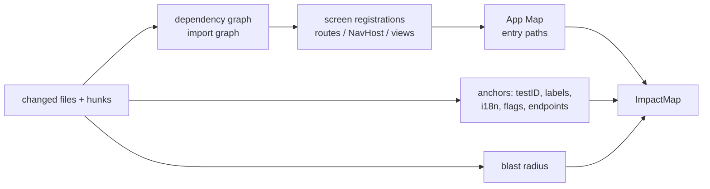

# 06 · Verification Plan: impact analysis and scenario generation

The plan is the heart of the difference between Revlee and "an agent that clicks until it gets bored". It is **explicit, cited, and published before execution**.

## 1. Impact Analyzer (deterministic, before the LLM)

### 1.1 Input → output



### 1.2 Screen detection per stack

| Stack | Screen registrations | Tool |
|---|---|---|
| React Native / Expo | `createNativeStackNavigator` `Screen name=…`, `app/**/*.tsx` files (Expo Router) | TS parser (ts-morph) + import graph (madge/Metro `--dependency-graph`) |
| Next.js / web | `app/**/page.tsx`, `pages/**`, `routes.ts` | file parser + import graph |
| Android (Kotlin) | `NavHost { composable("…") }`, `Activity`/`Fragment` in the manifest, `nav_graph.xml` | kotlin-analysis lite / regex + Gradle module graph |
| iOS (Swift) | `NavigationStack`, `.navigationDestination`, storyboards, `UIViewController` | SourceKitten / regex + target graph |
| Flutter | `GoRouter` routes, `Navigator.pushNamed` | Dart analyzer |

The `.revlee/screens.yaml` file overrides/complements the detection. When the stack cannot be parsed: fallback = changed files → the LLM proposes screens (marked `confidence: low`).

### 1.3 Blast radius

| `blast_radius` | Condition | Effect on the plan |
|---|---|---|
| `local` | changes only in files assigned to ≤ 2 screens | scenarios only for those screens |
| `shared_component` | change in `shared.files` (theme, UI components, hooks) | + smoke on `smoke_screens` (base vs PR differential comparison, no AC) |
| `layout` | navigation, root layout, tab bar | + smoke on all App Map screens with `heat ≥ p50` (limit 8) |
| `global` | native dependencies, build config, i18n root, flags | + smoke launch + 5 most frequent screens; the plan is marked `coverage: partial` |
| `none` | only tests/CI/docs | `skip: no_user_visible_change` (unless the AC say otherwise) |

### 1.4 `ImpactMap` schema

```json
{
  "schema": "revlee.impact_map/1",
  "screens": [
    { "id": "product", "confidence": 0.95, "why": ["src/screens/ProductScreen.tsx modified (h1)"], "entry_path": ["home", "tap:tab Products", "tap:first product card"], "last_observation": "obs_9f3", "anchors": { "test_ids": ["add-to-cart", "cart-badge"], "i18n_keys": ["cart.added"] } },
    { "id": "home", "confidence": 0.6, "why": ["theme.ts shared_component"], "entry_path": [], "smoke_only": true }
  ],
  "blast_radius": "shared_component",
  "unmapped_files": ["src/utils/format.ts"],
  "feature_flags": [{ "name": "newToast", "default": true, "source": "src/flags.ts" }],
  "api_endpoints_touched": [],
  "coverage": { "mapped_hunks": 3, "total_hunks": 3 }
}
```

## 2. Planner (LLM)

### 2.1 Contract

A single call to the `models.planner` model with an enforced JSON schema. Input: `TaskContext`, `ImpactMap`, `always_verify[]`, `scope_hint`, the previous plan (if any). Output: `VerificationPlan`.

Hard rules of the system prompt (summary; full prompt in `packages/planner/prompts/plan.md`):

1. Every `claimed_behavior` must have a `source_ref` to a ticket AC, a diff hunk, or a line of the PR description. No source → it must not be added.
2. Every AC → ≥ 1 scenario, or an entry in `cannot_verify_via_ui` with a code.
3. Scenario = preconditions + ≤ 12 steps in natural, platform-independent language ("tap the *Add to cart* button", not "click @e12") + ≥ 1 oracle + 1 negative control.
4. Choose oracles starting from the strongest: `a11y_assert` → `state_assert` → `visual_diff_vs_base` → `vlm_rubric`. `vlm_rubric` only for properties not visible in the a11y tree (color, layout, chart, animation).
5. Mark `expected_on_base: same|different|absent` for every oracle (enables the differential comparison).
6. No actions from the `security.deny_actions` list (payments, account deletion, sending messages) and nothing outside the app under test.
7. Prefer deep links / `auth_bypass` from the playbook over clicking through the login.
8. Do not plan more than `budget.max_scenarios` (default 8 + smoke); if there are more AC, prioritize by `kind` (behavior > state > visual) and report `coverage: partial`.
9. If an AC contradicts the diff (e.g. the AC says green, the diff sets red) → the scenario must check the **AC**, and the discrepancy goes into `notes` as a potential finding.

### 2.2 `VerificationPlan` schema

```json
{
  "schema": "revlee.verification_plan/1",
  "plan_id": "pr88-a1b2c3d-android",
  "change_intent": "Change the 'Add to cart' CTA to green and add a confirmation toast; the cart counter increases.",
  "claimed_behaviors": [
    { "id": "B1", "text": "CTA has color #1DB954", "source_ref": "SHOP-412#ac:1", "kind": "visual" },
    { "id": "B2", "text": "Toast 'Added: {name}' after tapping, disappears after 3 s", "source_ref": "SHOP-412#ac:2", "kind": "behavior" },
    { "id": "B3", "text": "Cart counter +1", "source_ref": "SHOP-412#ac:3", "kind": "state" },
    { "id": "B4", "text": "The new Toast component does not cover the tab bar", "source_ref": "pr:h3", "kind": "visual", "derived": true }
  ],
  "scenarios": [
    {
      "id": "S1",
      "title": "Adding a product to the cart shows a toast and increases the counter",
      "covers": ["B2", "B3", "B4"],
      "preconditions": { "auth": "customer", "screen": "product", "data": "product 'Orchid Mantis' visible", "flags": { "newToast": true } },
      "steps": [
        { "n": 1, "action": "navigate", "text": "Go to the product screen for 'Orchid Mantis'", "expect_after": "title 'Orchid Mantis' and the 'Add to cart' button are visible" },
        { "n": 2, "action": "observe", "text": "Read the cart counter", "extract": { "name": "cart_before", "from": "testID cart-badge" } },
        { "n": 3, "action": "tap", "text": "Tap 'Add to cart'", "expect_after": "a toast 'Added: Orchid Mantis' appears" },
        { "n": 4, "action": "wait", "text": "Wait 3.5 s", "expect_after": "the toast has disappeared" }
      ],
      "oracles": [
        { "id": "O1", "type": "a11y_assert", "covers": "B2", "assert": { "text_contains": "Added: Orchid Mantis" }, "at_step": 3, "expected_on_base": "absent" },
        { "id": "O2", "type": "a11y_assert", "covers": "B2", "assert": { "text_absent": "Added:" }, "at_step": 4, "expected_on_base": "same" },
        { "id": "O3", "type": "state_assert", "covers": "B3", "assert": { "test_id": "cart-badge", "value_equals": "${cart_before + 1}" }, "at_step": 4, "expected_on_base": "same" },
        { "id": "O4", "type": "vlm_rubric", "covers": "B4", "rubric": "The toast does not overlap the bottom tab bar; all 3 tab icons are fully visible", "vision": "required", "at_step": 3, "expected_on_base": "absent" }
      ],
      "negative_controls": [
        { "id": "N1", "text": "On the base build, no toast appears after tapping", "compare_with_base": true },
        { "id": "N2", "text": "The counter does not increase by more than 1", "assert": { "test_id": "cart-badge", "value_not": "${cart_before + 2}" } }
      ],
      "compare_with_base": true,
      "budget": { "max_steps": 12, "max_model_calls": 20 }
    },
    {
      "id": "S2",
      "title": "CTA color",
      "covers": ["B1"],
      "preconditions": { "screen": "product" },
      "steps": [{ "n": 1, "action": "navigate", "text": "Product screen", "expect_after": "the 'Add to cart' button is visible" }],
      "oracles": [
        { "id": "O5", "type": "visual_diff_vs_base", "covers": "B1", "region": { "test_id": "add-to-cart" }, "expected_on_base": "different", "classify_against_intent": true },
        { "id": "O6", "type": "vlm_rubric", "covers": "B1", "rubric": "The 'Add to cart' button is green (a shade close to #1DB954), not blue or red", "vision": "required", "votes": 3, "expected_on_base": "different" }
      ],
      "negative_controls": [{ "id": "N3", "text": "On base, the button is not green", "compare_with_base": true }],
      "compare_with_base": true
    }
  ],
  "smoke": [
    { "id": "K1", "screen": "home", "reason": "theme.ts shared_component", "oracle": "visual_diff_vs_base", "expected": "no_unintended_change" },
    { "id": "K2", "screen": "cart", "reason": "theme.ts shared_component", "oracle": "visual_diff_vs_base", "expected": "no_unintended_change" }
  ],
  "always_verify": [{ "id": "AV1", "text": "The app launches to the Home screen without crashing", "oracle": "a11y_assert" }],
  "cannot_verify_via_ui": [],
  "coverage": { "ac_total": 3, "ac_covered": 3, "status": "full" },
  "estimated": { "steps": 9, "model_calls": 18, "usd": 1.6, "minutes": 5 },
  "notes": []
}
```

### 2.3 Plan quality control (deterministic, after the LLM)

The validator rejects the plan (and asks the model for a fix, max. 2 rounds) when:
- there is a `claimed_behavior` without a `source_ref` or with a `source_ref` that does not exist in the `TaskContext`,
- an AC has no scenario and no entry in `cannot_verify_via_ui`,
- a scenario has no oracle or no negative control,
- a step uses technical references (`@e12`, coordinates),
- `vlm_rubric` is used where an a11y anchor exists (`anchors.test_ids` covers the element),
- the scenario/step budget is exceeded,
- a step touches `deny_actions`.

## 3. Presenting the plan in the PR (before execution)

The Reporter publishes the plan as a table in a comment (later updated with the results):

```
### Verification plan · PR #88 · a1b2c3d · Android (Pixel 7 / API 35)
| # | Criterion | Source | Scenario | Oracle | Base |
|---|---|---|---|---|---|
| AC1 | CTA color #1DB954 | SHOP-412 | S2 | odiff + judge ×3 | comparison |
| AC2 | Toast after tapping, disappears after 3 s | SHOP-412 | S1 | a11y | negative control |
| AC3 | Counter +1 | SHOP-412 | S1 | state | — |
| B4 | Toast does not cover the tab bar | diff h3 (derived) | S1 | judge | — |
| smoke | Home, Cart without unintended changes | theme.ts | K1,K2 | odiff | comparison |
⏳ running… (est. 5 min, ≤ 1.6 USD)
```

The reviewer can react before the run finishes (`/verify stop`, `/verify "skip smoke"`).

## 4. Plan modes

| Mode | When | Behavior |
|---|---|---|
| `ac_driven` (default) | AC are present | as above |
| `diff_driven` | no AC, screens are present | scenarios of the form "the change from the hunk is visible and works", verdict ≤ `ready_with_issues`, request for AC |
| `explore` | `/verify explore` or `blast_radius: global` | BFS over the ImpactMap screens with a step budget; oracle: no crashes, no errors in the logs, differential odiff; feeds the App Map |
| `regression_only` | PR without UI changes, but the team has `.revlee/flows/*.ad` | only script replay (zero model) + report |

## 5. Identifier stability across pushes

The Planner receives the previous plan and must keep the `scenario_id` for scenarios covering the same AC (identical `covers`). Thanks to this, the step cache and the finding history survive subsequent pushes. A change of AC in the ticket between pushes is reported as a `plan_delta`.
