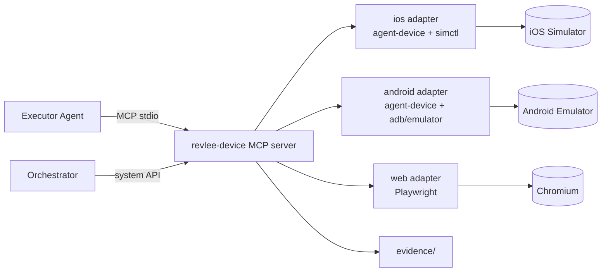

# 07 · Device and Build Layer

## 1. Build Service

### 1.1 Principles

- **Build once per SHA × platform**, in a separate job; verification only installs.
- **Debug / simulator** build (iOS: `-sdk iphonesimulator`, `CODE_SIGNING_ALLOWED=NO`; Android: `assembleDebug`, ABI matching the host: `x86_64` on Linux/KVM, `arm64-v8a` on Apple Silicon).
- **Base branch** build for the differential comparison: fetched from the cache by `base_sha` (built by the `push` workflow on `main`), and if missing, built in the same job (cost ~+50 %).
- **Native build reuse** for JS-only changes (Expo/RN): `@expo/fingerprint` → if the native fingerprint matches the last `main` build, we install the old `.app/.apk` and serve the new JS bundle (dev client / embedded bundle rebuild of JS only).
- Metadata in `build.json`: `platform, head_sha, base_sha, pr_number, fingerprint, bundle_id/package, artifact_sha256, build_duration_s, toolchain`.

### 1.2 Example commands

```bash
# iOS (Mac, Xcode 27)
xcodebuild -workspace ios/App.xcworkspace -scheme App -configuration Debug \
  -sdk iphonesimulator -destination 'generic/platform=iOS Simulator' \
  -derivedDataPath build/dd CODE_SIGNING_ALLOWED=NO build
ditto -c -k --keepParent build/dd/Build/Products/Debug-iphonesimulator/App.app build/App.app.zip

# Android (Linux)
./gradlew :app:assembleDebug --build-cache --configuration-cache \
  -Pandroid.injected.testOnly=false
cp app/build/outputs/apk/debug/app-debug.apk build/app.apk

# Web
npm run build && (npm run start -- --port 3000 &) && npx wait-on http://localhost:3000
```

### 1.3 Cache (the key to < 10 min)

| Layer | Mechanism |
|---|---|
| Gradle | remote build cache (HTTP node, e.g. `gradle/build-cache-node` on the runner host), `configuration-cache`, warm daemon on a persistent host |
| Xcode | only `Build/Products` + SPM/CocoaPods cache on the host's local disk (not the whole DerivedData) |
| Node | `node_modules` from the host's local cache (`actions/cache` is slow for GBs) |
| Emulator | AVD with a Quick Boot snapshot in the VM/pod image |
| Simulator | runtime pre-registered in the VM image, simulator pre-booted in a VM snapshot (bypasses the "initial simulator launch can take several minutes" of Xcode 27.1) |

## 2. Device Layer: `revlee-device`

### 2.1 Architecture



The MCP server is the agent's **only** channel to the device. The Orchestrator uses a separate, privileged API (start/stop/install/record) that is not available as an MCP tool.

### 2.2 Tools available to the agent

| Tool | Parameters | Returns | Notes |
|---|---|---|---|
| `observe` | `{ interactive_only?, with_screenshot?: 'auto'\|'always'\|'never', settle_ms? }` | a11y snapshot with refs (`@e12 [button] "Add to cart" testID=add-to-cart`), diff against the previous one, `screen_fingerprint`, optionally a screenshot | `auto` attaches a screenshot when the snapshot has < N interactive elements or a canvas/WebView was detected |
| `tap` / `long_press` / `double_tap` | `{ ref }` or `{ selector }` or `{ x, y }` (only when `vision` is allowed) | snapshot diff after `settle` | coordinates logged as `grounding: vision` |
| `type` | `{ ref, text }` | diff | text logged |
| `type_secret` | `{ ref, secret_name }` | diff | value from the Orchestrator's keychain; afterwards `PIXEL_TAINTED` blocks screenshots until the screen changes |
| `swipe` / `scroll` | `{ direction, until?: selector, amount? }` | diff | prefer `until` |
| `press_key` | `{ key: back\|home\|enter\|… }` | diff | |
| `open_link` | `{ url }` | diff | only schemes/hosts from the allow-list |
| `wait_stable` | `{ quiet_ms, timeout_ms }` | snapshot | no model |
| `wait_for` | `{ selector \| text, timeout_ms, absent? }` | bool + snapshot | deterministic |
| `assert_element` | `{ selector \| text \| test_id, state: visible\|absent\|enabled\|value= }` | `{ ok, actual, evidence_id }` | **deterministic oracle**; evidence recorded |
| `screenshot` | `{ label, annotate_refs? }` | `evidence_id` | always saved; sent to the model only when allowed |
| `read_logs` | `{ since_mark?, level?, grep? }` | lines | app-only |
| `network_dump` | `{ since_mark?, host_filter? }` | requests | headers without secrets |
| `mark` | `{ label }` | — | marker in logs/video |

Every call writes an entry to `evidence/actions.ndjson` (time, tool, parameters, `screen_fingerprint` before/after, `evidence_id`).

### 2.3 System tools (Orchestrator only)

`device.start(profile)`, `device.install(artifact)`, `device.launch(bundle, args, env)`, `device.deeplink(url)`, `device.grant_permissions([...])`, `device.set_status_bar(...)`, `device.record.start/stop`, `device.state.snapshot/diff`, `device.reset()`, `device.stop()`.

### 2.4 Enforced rules

| Rule | Mechanism | Error |
|---|---|---|
| One device | the server starts with `--device <id>` and rejects others | `DEVICE_SCOPE` |
| Only the app under test | the foreground is checked after every action (`adb shell dumpsys window` / `simctl` + a11y root); exception: system permission dialogs | `FOREGROUND_VIOLATION` (action reverted with `home` + relaunch) |
| No secrets in images | `type_secret` sets a taint flag until the screen fingerprint changes | `PIXEL_TAINTED` |
| Network | emulator `-http-proxy` / simulator proxy → mitmproxy with the `security.allowed_hosts` allow-list; everything else 403 | logged as `NETWORK_BLOCKED` |
| Forbidden actions | `PreToolUse` hook in the Agent SDK: deny when the target label matches `deny_actions` (e.g. "Pay", "Delete account") | `ACTION_DENIED` |
| Budget | turn and cost counter in the Orchestrator; once exceeded, the server returns `BUDGET_EXCEEDED` and rejects mutating actions | |

### 2.5 Adapters

**iOS (`xcrun simctl` + agent-device):**
```bash
UDID=$(xcrun simctl create "revlee-$RUN_ID" "iPhone 17" com.apple.CoreSimulator.SimRuntime.iOS-27-0)
xcrun simctl boot "$UDID" && xcrun simctl bootstatus "$UDID" -b
xcrun simctl privacy "$UDID" grant all com.acme.shop
xcrun simctl status_bar "$UDID" override --time 9:41 --batteryState charged --batteryLevel 100 --cellularBars 4 --wifiBars 3
xcrun simctl install "$UDID" build/App.app
xcrun simctl io "$UDID" recordVideo --codec h264 --force evidence/run.mp4 &   # kill -INT to stop
xcrun simctl launch "$UDID" com.acme.shop -UITestMode 1
xcrun simctl openurl "$UDID" "acme://e2e/auth?token=$E2E_TOKEN"
agent-device open com.acme.shop --platform ios --device "$UDID" --session "$RUN_ID"
```
A11y snapshots and actions go through agent-device (a11y bridge + XCTest). After the run: `shutdown` + `delete`.

**Android (`emulator`/`adb` + agent-device):**
```bash
emulator @revlee_api35 -no-window -gpu swiftshader_indirect -noaudio -no-boot-anim \
  -read-only -no-snapshot-save -port 5554 -memory 4096 -http-proxy http://127.0.0.1:8080 &
adb -s emulator-5554 wait-for-device
until [ "$(adb -s emulator-5554 shell getprop sys.boot_completed | tr -d '\r')" = "1" ]; do sleep 1; done
for k in window_animation_scale transition_animation_scale animator_duration_scale; do adb shell settings put global $k 0; done
adb install -r -t build/app.apk
adb shell screenrecord --time-limit 600 /sdcard/run.mp4 &
adb shell am start -W -a android.intent.action.VIEW -d "acme://e2e/auth?token=$E2E_TOKEN" com.acme.shop
agent-device open com.acme.shop --platform android --device emulator-5554 --session "$RUN_ID"
```
`-read-only` allows running N instances of one AVD with a shared Quick Boot snapshot. Logs: `adb logcat -v threadtime`; tree: agent-device snapshot (fallback `uiautomator dump`).

**Web (Playwright):**
`chromium.launch({ headless: true })`, `context.tracing.start({ screenshots: true, snapshots: true })`, `recordVideo`, a11y snapshot via `page.accessibility`/aria snapshot, actions via `getByRole/getByText/getByTestId` locators. The `trace.zip` trace is first-class evidence (opened in trace.playwright.dev from an S3 URL).

### 2.6 Screen fingerprint

`screen_fingerprint = sha1(normalize(a11y_tree))`, where normalization: removes dynamic values (numbers, dates, times, identifiers), keeps roles, static names, testIDs, order. The distance between fingerprints (Jaccard over node sets) drives: cache hit (≥ 0.9), locator heal (0.7–0.9), drift (< 0.7). The same fingerprint identifies the screen in the App Map.

## 3. Determinism of the app under test

Recommendations for the team (document `docs/guides/app-readiness.md` in the target repo):

1. **Auth bypass** via deep link / launch arg only in Debug builds (`acme://e2e/auth?token=…`, `-UITestMode 1`, `--es e2e_token`). Token from the Orchestrator's secrets, never in prompts.
2. **Test hooks**: deep links to specific screens (`acme://e2e/screen/product/123`), state reset (`acme://e2e/reset`), data seeding.
3. **Network**: mock (MSW in RN/web, WireMock on the host) or recorded responses via mitmproxy; for the differential comparison, **the same** set of responses for base and PR.
4. **Animations** disabled (Android settings, iOS `UIView.setAnimationsEnabled(false)` behind a flag), fixed time/status bar.
5. **testID / accessibilityIdentifier** on key controls: increases the share of deterministic oracles and cache hits.

## 4. Evidence store

```
evidence/<run_id>/
  manifest.json            # index of everything below + hashes
  build.json
  task_context.json
  impact_map.json
  plan.json
  actions.ndjson           # every agent step
  observations/<n>.json    # a11y snapshot + fingerprint
  screenshots/<n>.png
  base/                    # the same structures for the base build
  diffs/<oracle_id>.png    # odiff heatmaps
  video/run.mp4 (+ contact-sheet.png)
  logs/app.log, network.json, device-state/*.json
  judge/<criterion>.json   # judge votes, cited evidence
  verdicts.json
  report.md, report.html, junit.xml
```

Flow: directory → Actions artifact (`retention-days: 14`, `compression-level: 0`) → mirror to S3/MinIO (`report.evidence.store`) with presigned URLs (lifecycle e.g. 30 days). The PR comment links to `report.html` in S3 and embeds media via `gh pr comment --attach`. Video: H.264 MP4 ≤ 100 MB (longer runs split into segments at scenario markers).
