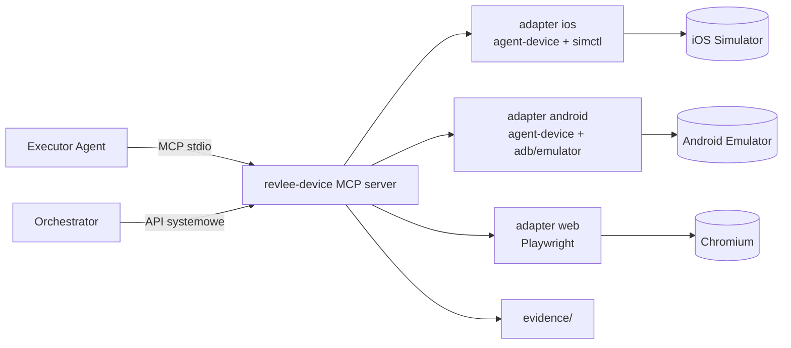

# 07 · Warstwa urządzeń i buildów

## 1. Build Service

### 1.1 Zasady

- **Build raz na SHA × platforma**, w osobnym jobie; weryfikacja tylko instaluje.
- Build **Debug / simulator** (iOS: `-sdk iphonesimulator`, `CODE_SIGNING_ALLOWED=NO`; Android: `assembleDebug`, ABI zgodne z hostem: `x86_64` na Linux/KVM, `arm64-v8a` na Apple Silicon).
- Build **gałęzi bazowej** do porównania różnicowego: pobierany z cache po `base_sha` (zbudowany przez workflow `push` na `main`), a jeśli brak, budowany w tym samym jobie (koszt ~+50 %).
- **Reużycie natywnego buildu** przy zmianach tylko JS (Expo/RN): `@expo/fingerprint` → jeśli fingerprint natywny zgodny z ostatnim buildem `main`, instalujemy stary `.app/.apk` i serwujemy nowy bundle JS (dev client / embedded bundle rebuild tylko JS).
- Metadane w `build.json`: `platform, head_sha, base_sha, pr_number, fingerprint, bundle_id/package, artifact_sha256, build_duration_s, toolchain`.

### 1.2 Przykładowe komendy

```bash
# iOS (Mac, Xcode 27)
xcodebuild -workspace ios/App.xcworkspace -scheme App -configuration Debug \
  -sdk iphonesimulator -destination 'generic/platform=iOS Simulator' \
  -derivedDataPath build/dd CODE_SIGNING_ALLOWED=NO build
ditto -c -k --keepParent build/dd/Build/Products/Debug-iphonesimulator/App.app build/App.app.zip

# Android (Linux)
./gradlew :app:assembleDebug --build-cache --configuration-cache \
  -Pandroid.injected.testOnly=false
cp app/build/outputs/apk/debug/app-debug.apk build/app.apk

# Web
npm run build && (npm run start -- --port 3000 &) && npx wait-on http://localhost:3000
```

### 1.3 Cache (klucz do < 10 min)

| Warstwa | Mechanizm |
|---|---|
| Gradle | zdalny build cache (HTTP node, np. `gradle/build-cache-node` na hoście runnerów), `configuration-cache`, ciepły daemon na trwałym hoście |
| Xcode | tylko `Build/Products` + SPM/CocoaPods cache na lokalnym dysku hosta (nie cały DerivedData) |
| Node | `node_modules` z lokalnego cache hosta (`actions/cache` jest wolny dla GB) |
| Emulator | AVD z Quick Boot snapshotem w obrazie VM/poda |
| Symulator | runtime pre-zarejestrowany w obrazie VM, symulator pre-bootowany w snapshocie VM (omija „initial simulator launch can take several minutes” z Xcode 27.1) |

## 2. Device Layer: `revlee-device`

### 2.1 Architektura



Serwer MCP jest **jedynym** kanałem agenta do urządzenia. Orchestrator używa osobnego, uprzywilejowanego API (start/stop/install/record), niedostępnego jako narzędzie MCP.

### 2.2 Narzędzia dostępne dla agenta

| Narzędzie | Parametry | Zwraca | Uwagi |
|---|---|---|---|
| `observe` | `{ interactive_only?, with_screenshot?: 'auto'\|'always'\|'never', settle_ms? }` | snapshot a11y z refami (`@e12 [button] "Dodaj do koszyka" testID=add-to-cart`), diff względem poprzedniego, `screen_fingerprint`, ewent. screenshot | `auto` dołącza screenshot, gdy snapshot ma < N interaktywnych elementów lub wykryto canvas/WebView |
| `tap` / `long_press` / `double_tap` | `{ ref }` lub `{ selector }` lub `{ x, y }` (tylko gdy `vision` dozwolone) | diff snapshotu po `settle` | współrzędne logowane jako `grounding: vision` |
| `type` | `{ ref, text }` | diff | tekst logowany |
| `type_secret` | `{ ref, secret_name }` | diff | wartość z keychaina Orchestratora; po tym `PIXEL_TAINTED` blokuje screenshoty do zmiany ekranu |
| `swipe` / `scroll` | `{ direction, until?: selector, amount? }` | diff | preferuj `until` |
| `press_key` | `{ key: back\|home\|enter\|… }` | diff | |
| `open_link` | `{ url }` | diff | tylko schematy/hosty z allow-listy |
| `wait_stable` | `{ quiet_ms, timeout_ms }` | snapshot | bez modelu |
| `wait_for` | `{ selector \| text, timeout_ms, absent? }` | bool + snapshot | deterministyczne |
| `assert_element` | `{ selector \| text \| test_id, state: visible\|absent\|enabled\|value= }` | `{ ok, actual, evidence_id }` | **orakulum deterministyczne**; zapis dowodu |
| `screenshot` | `{ label, annotate_refs? }` | `evidence_id` | zawsze zapisywany; do modelu tylko gdy dozwolone |
| `read_logs` | `{ since_mark?, level?, grep? }` | linie | app-only |
| `network_dump` | `{ since_mark?, host_filter? }` | żądania | nagłówki bez sekretów |
| `mark` | `{ label }` | — | znacznik w logach/wideo |

Każde wywołanie zapisuje wpis w `evidence/actions.ndjson` (czas, narzędzie, parametry, `screen_fingerprint` przed/po, `evidence_id`).

### 2.3 Narzędzia systemowe (tylko Orchestrator)

`device.start(profile)`, `device.install(artifact)`, `device.launch(bundle, args, env)`, `device.deeplink(url)`, `device.grant_permissions([...])`, `device.set_status_bar(...)`, `device.record.start/stop`, `device.state.snapshot/diff`, `device.reset()`, `device.stop()`.

### 2.4 Egzekwowane reguły

| Reguła | Mechanizm | Błąd |
|---|---|---|
| Jedno urządzenie | serwer startuje z `--device <id>` i odrzuca inne | `DEVICE_SCOPE` |
| Tylko aplikacja pod testem | po każdej akcji sprawdzany foreground (`adb shell dumpsys window` / `simctl` + a11y root); wyjątek: systemowe dialogi uprawnień | `FOREGROUND_VIOLATION` (akcja cofnięta `home` + relaunch) |
| Brak sekretów na obrazach | `type_secret` ustawia flagę taint do zmiany fingerprintu ekranu | `PIXEL_TAINTED` |
| Sieć | emulator `-http-proxy` / symulator proxy → mitmproxy z allow-listą `security.allowed_hosts`; reszta 403 | logowane jako `NETWORK_BLOCKED` |
| Zakazane akcje | hook `PreToolUse` w Agent SDK: deny gdy etykieta celu pasuje do `deny_actions` (np. „Zapłać”, „Usuń konto”) | `ACTION_DENIED` |
| Budżet | licznik tur i kosztów w Orchestratorze; po przekroczeniu serwer zwraca `BUDGET_EXCEEDED` i odrzuca akcje mutujące | |

### 2.5 Adaptery

**iOS (`xcrun simctl` + agent-device):**
```bash
UDID=$(xcrun simctl create "revlee-$RUN_ID" "iPhone 17" com.apple.CoreSimulator.SimRuntime.iOS-27-0)
xcrun simctl boot "$UDID" && xcrun simctl bootstatus "$UDID" -b
xcrun simctl privacy "$UDID" grant all com.acme.shop
xcrun simctl status_bar "$UDID" override --time 9:41 --batteryState charged --batteryLevel 100 --cellularBars 4 --wifiBars 3
xcrun simctl install "$UDID" build/App.app
xcrun simctl io "$UDID" recordVideo --codec h264 --force evidence/run.mp4 &   # kill -INT by zatrzymać
xcrun simctl launch "$UDID" com.acme.shop -UITestMode 1
xcrun simctl openurl "$UDID" "acme://e2e/auth?token=$E2E_TOKEN"
agent-device open com.acme.shop --platform ios --device "$UDID" --session "$RUN_ID"
```
Snapshoty a11y i akcje przez agent-device (bridge a11y + XCTest). Po runie `shutdown` + `delete`.

**Android (`emulator`/`adb` + agent-device):**
```bash
emulator @revlee_api35 -no-window -gpu swiftshader_indirect -noaudio -no-boot-anim \
  -read-only -no-snapshot-save -port 5554 -memory 4096 -http-proxy http://127.0.0.1:8080 &
adb -s emulator-5554 wait-for-device
until [ "$(adb -s emulator-5554 shell getprop sys.boot_completed | tr -d '\r')" = "1" ]; do sleep 1; done
for k in window_animation_scale transition_animation_scale animator_duration_scale; do adb shell settings put global $k 0; done
adb install -r -t build/app.apk
adb shell screenrecord --time-limit 600 /sdcard/run.mp4 &
adb shell am start -W -a android.intent.action.VIEW -d "acme://e2e/auth?token=$E2E_TOKEN" com.acme.shop
agent-device open com.acme.shop --platform android --device emulator-5554 --session "$RUN_ID"
```
`-read-only` pozwala uruchomić N instancji jednego AVD ze wspólnym snapshotem Quick Boot. Logi: `adb logcat -v threadtime`; drzewo: agent-device snapshot (fallback `uiautomator dump`).

**Web (Playwright):**
`chromium.launch({ headless: true })`, `context.tracing.start({ screenshots: true, snapshots: true })`, `recordVideo`, snapshot a11y przez `page.accessibility`/aria snapshot, akcje przez locatory `getByRole/getByText/getByTestId`. Trace `trace.zip` jest dowodem pierwszej klasy (otwierany w trace.playwright.dev z S3 URL).

### 2.6 Fingerprint ekranu

`screen_fingerprint = sha1(normalize(a11y_tree))`, gdzie normalizacja: usuwa wartości dynamiczne (liczby, daty, czasy, identyfikatory), zachowuje role, nazwy statyczne, testID, kolejność. Dystans między fingerprintami (Jaccard zbiorów węzłów) steruje: cache hit (≥ 0,9), locator-heal (0,7–0,9), drift (< 0,7). Ten sam fingerprint identyfikuje ekran w App Map.

## 3. Determinizm aplikacji pod testem

Zalecenia dla zespołu (dokument `docs/guides/app-readiness.md` w repo docelowym):

1. **Auth bypass** przez deep link / launch arg tylko w buildach Debug (`acme://e2e/auth?token=…`, `-UITestMode 1`, `--es e2e_token`). Token z sekretów Orchestratora, nigdy w promptach.
2. **Test hooks**: deep linki do konkretnych ekranów (`acme://e2e/screen/product/123`), reset stanu (`acme://e2e/reset`), seed danych.
3. **Sieć**: mock (MSW w RN/web, WireMock na hoście) albo nagrane odpowiedzi przez mitmproxy; dla porównania różnicowego **ten sam** zestaw odpowiedzi dla base i PR.
4. **Animacje** wyłączone (Android settings, iOS `UIView.setAnimationsEnabled(false)` pod flagą), stały czas/status bar.
5. **testID / accessibilityIdentifier** na kluczowych kontrolkach: podnosi udział orakli deterministycznych i trafienia cache.

## 4. Evidence store

```
evidence/<run_id>/
  manifest.json            # indeks wszystkiego poniżej + hashe
  build.json
  task_context.json
  impact_map.json
  plan.json
  actions.ndjson           # każdy krok agenta
  observations/<n>.json    # snapshot a11y + fingerprint
  screenshots/<n>.png
  base/                    # te same struktury dla buildu bazowego
  diffs/<oracle_id>.png    # heatmapy odiff
  video/run.mp4 (+ contact-sheet.png)
  logs/app.log, network.json, device-state/*.json
  judge/<criterion>.json   # głosy sędziów, cytowane dowody
  verdicts.json
  report.md, report.html, junit.xml
```

Przepływ: katalog → artefakt Actions (`retention-days: 14`, `compression-level: 0`) → mirror do S3/MinIO (`report.evidence.store`) z presigned URL (lifecycle np. 30 dni). Komentarz PR linkuje do `report.html` w S3 i osadza media przez `gh pr comment --attach`. Wideo: H.264 MP4 ≤ 100 MB (dłuższe runy dzielone na segmenty po znacznikach scenariuszy).
