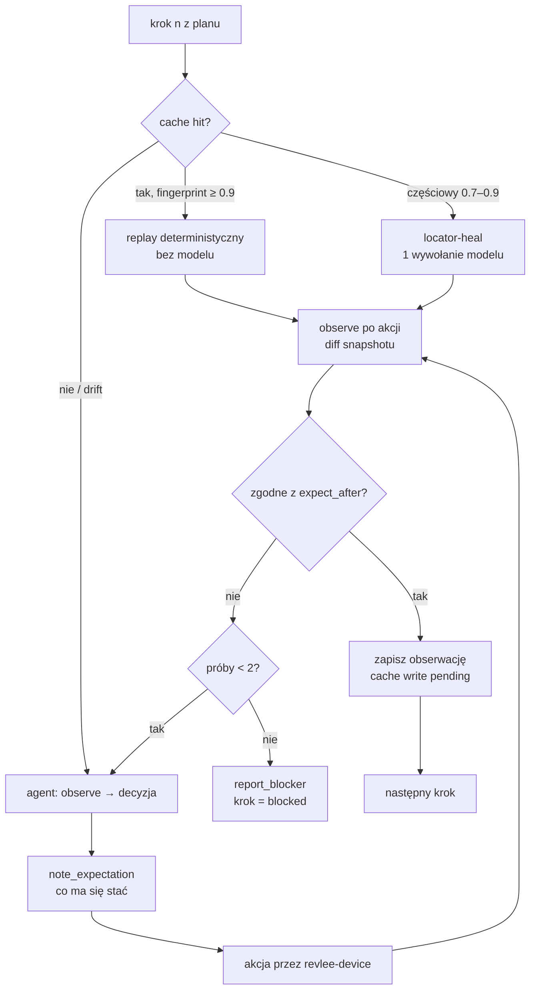

# 08 · Agent wykonawczy, orakula i sędzia

## 1. Executor Agent

### 1.1 Rola i granice

Executor wykonuje scenariusze z planu. **Nie ocenia wyniku** (to robi warstwa orakli), tylko: nawiguje, działa, zapisuje oczekiwania i obserwacje. Działa na Claude Agent SDK z zestawem narzędzi ograniczonym do `revlee-device` (allow-lista `mcp__revlee_device__*`) plus dwa narzędzia własne: `note_expectation` i `report_blocker`. Brak `Bash`, `Edit`, `Write`, brak GitHuba.

### 1.2 Pętla kroku



Reguły:
- **Oczekiwanie przed akcją** (`note_expectation`) jest obowiązkowe i trafia do `actions.ndjson`; porównanie oczekiwania z obserwacją po akcji to sygnał dla sędziego, ale **nie werdykt**.
- **Percepcja a11y-first.** Screenshot dołączany do kontekstu modelu tylko gdy: snapshot ma mało elementów interaktywnych (< 3) lub wykryto `canvas/WebView/Image` jako jedyny element, scenariusz ma `vision: required`, albo agent jawnie zażąda (`with_screenshot: 'always'`) — każde żądanie liczone do budżetu wizji (`budget.max_screenshots_to_model`).
- **Grounding wizyjny** (tap po współrzędnych) dozwolony tylko po nieudanym tapie po refie/selektorze; opcjonalnie przez lokalny model groundingu (`models.grounding`, np. UI-TARS-1.5-7B przez vLLM), wtedy duży model nie widzi screenshotu w ogóle.
- **Detekcja pętli:** 3 kolejne identyczne fingerprinty po akcjach mutujących → model dostaje instrukcję zmiany podejścia; 5 → krok `blocked`.
- **Jeden recovery na scenariusz** (wzorzec Momentic): po jednej udanej naprawie dalsze błędy kończą scenariusz jako `blocked`, aby nie kumulować błędów.
- **Kontekst modelu:** okno przesuwne ostatnich 6 obserwacji + streszczenie wcześniejszych; obrazy starsze niż 3 kroki usuwane z kontekstu (server-side tool-result clearing w Agent SDK); prompt caching dla części stałej (plan, playbook).

### 1.3 Zapis obserwacji

Każdy krok → `observation`:
```json
{ "scenario": "S1", "step": 3, "ts": "…", "source": "agent|replay|heal",
  "expectation": "pojawia się toast 'Dodano: Orchid Mantis'",
  "action": { "tool": "tap", "target": { "ref": "@e12", "role": "button", "name": "Dodaj do koszyka", "test_id": "add-to-cart" } },
  "before": { "fingerprint": "sha1:…", "snapshot_id": "obs_41" },
  "after": { "fingerprint": "sha1:…", "snapshot_id": "obs_42", "screenshot_id": "shot_17", "diff_summary": "+ [text] 'Dodano: Orchid Mantis' ; = 38 nodes" },
  "expectation_met_by_agent": true,
  "model_calls": 1, "tokens_in": 4120, "tokens_out": 180, "usd": 0.011 }
```
Narracja/rozumowanie agenta zapisywane są osobno (`agent_transcript.jsonl`) i **nie są wejściem sędziego**.

## 2. Cache i replay kroków

### 2.1 Co i jak cache'ujemy (wzorzec e2e + agent-device `.ad`)

- **Klucz:** `sha256(project, platform, scenario_id, step_n, instruction_norm, before.fingerprint_class, device_profile)`. `fingerprint_class` to fingerprint po usunięciu wartości dynamicznych; profil urządzenia = model + wersja OS + orientacja + locale.
- **Wartość:** zapis akcji jako **cel semantyczny** (`role`, `name`, `test_id`, kontekst rodzica), wpisany tekst (sekrety jako nazwa), kontrola stanu końcowego (route/tytuł ekranu + do 8 elementów, które pojawiły się / zniknęły), **oraz** wygenerowana linia `.ad` (`press id="add-to-cart"`) do replaya przez agent-device.
- **Zapis:** tylko po tym, jak orakulum deterministyczne kroku lub scenariusza przeszło (nigdy przy `fail`/`blocked`). Asercje i sędzia nigdy nie są cache'owane (zawsze „na żywo”).
- **Przechowywanie:** `.revlee/cache/<platform>/<scenario>.json` w artefaktach + indeks w bazie App Map; opcjonalnie commit do repo (tryb „test data”, jak e2e), wtedy PR może zmienić cache i recenzent to widzi.

### 2.2 Replay i unieważnianie

| Sytuacja | Zachowanie |
|---|---|
| fingerprint ≥ 0,9 i cel znaleziony | replay (0 wywołań modelu), `source: replay` |
| cel nieznaleziony, fingerprint 0,7–0,9 | locator-heal: model dostaje snapshot i cel semantyczny, wybiera ref; `source: heal`, cache aktualizowany po sukcesie |
| fingerprint < 0,7 lub ekran z `ImpactMap` bieżącego diffu | `stale` → agent od zera; `source: agent` |
| wersja OS/urządzenie inna niż w kluczu | miss (osobny klucz) |
| `/verify again` | cache ignorowany (tryb `off`) |
| drugi push na PR | kroki na ekranach poza `ImpactMap` → replay; na dotkniętych → agent |

Raport pokazuje per krok: `replayed | healed | agent | blocked`, oraz udział tokenów oszczędzonych.

## 3. Hierarchia orakli

| Poziom | Typ | Jak działa | Może dać `pass`? |
|---|---|---|---|
| 1 | `a11y_assert` | `assert_element` na snapshotcie (rola/nazwa/testID/tekst/wartość/stan) | tak |
| 2 | `state_assert` | wartość z ekstrakcji (`extract`), logi (`read_logs` grep), żądanie sieciowe (`network_dump`), opcjonalnie read-only zapytanie do backendu testowego/sqlite (`device.state`) | tak |
| 3 | `visual_diff_vs_base` | ten sam krok na base i PR → (a) diff drzew a11y, (b) `odiff` z `ignore-regions.yaml` i progiem; LLM **tylko klasyfikuje** różnicę jako `intended | unintended | neutral` względem `change_intent` | tak, gdy diff zgodny z `expected_on_base` i klasyfikacja `intended` jednomyślna |
| 4 | `vlm_rubric` | sędzia VLM z rubryką, N próbek (domyślnie 3, dwie rodziny modeli), wymóg cytowania dowodu | tak, tylko przy jednomyślności i cytacie |
| 5 | swobodny osąd | „czy coś wygląda źle?” | **nie**; może tylko obniżyć do `inconclusive` lub dodać `finding` |

Zasada: **najsilniejsze dostępne orakulum wygrywa**. Jeśli `a11y_assert` przeszło, a sędzia VLM „ma wątpliwości”, wynik to `pass` z `finding` o niskiej wadze, nie `inconclusive`.

## 4. Sędzia (LLM-as-judge) — konstrukcja odporna na fałszywe „pass”

Dowody z badań (AgentRewardBench ~70 % precyzji sędziów; Mobile-JudgeBench: „surface UI match”, „partial completion”; Gaming the Judge: narracja agenta podnosi fałszywe pass o 90 %) przekładają się na reguły:

1. **Wejście sędziego** = rubryka + oczekiwany wynik + obserwacje (screenshoty i/lub snapshoty a11y z oznaczonymi indeksami) + ewentualnie para base/PR. **Nigdy** transkrypt agenta, nigdy `expectation_met_by_agent`.
2. **Wyjście strukturalne**: `{ verdict: pass|fail|inconclusive, evidence: [{ observation_id, element_or_bbox, why }], unmet_subcriteria: [...], notes }`. Brak cytatu dowodu → odpowiedź odrzucona i powtórzona; drugi brak → `inconclusive`.
3. **Checklista podkryteriów**: rubryka rozbijana na atomowe punkty (np. „toast widoczny”, „tekst zawiera nazwę produktu”, „toast znikł po ≤ 3,5 s”); sędzia ocenia każdy osobno (przeciw „partial completion”).
4. **Głosowanie**: N = 3 niezależne próbki (temperatura > 0 lub różne modele: np. 2× Claude Sonnet 5.5 + 1× GPT-5.4). `pass` tylko przy 3/3; 2/3 → `inconclusive`; ≥ 1 `fail` z cytowanym dowodem → `fail` po weryfikacji przez 4. próbkę.
5. **Kontrola negatywna** zawsze oceniana tym samym sędzią: dowód, że sędzia potrafi powiedzieć „nie” (base nie pokazuje nowego elementu). Sędzia, który dał `pass` kontroli negatywnej mimo braku zmiany, unieważnia swoje głosy w tym runie (`judge_calibration_failed`).
6. **Przeciw „surface UI match”**: dla kryteriów `behavior` sędzia dostaje **sekwencję** (przed → akcja → po), nie pojedynczy ekran.
7. **Pewność** liczona, nie deklarowana: `confidence = w_oracle × agreement × evidence_quality`, gdzie `w_oracle` ∈ {1.0 a11y, 0.95 state, 0.85 visual_diff, 0.7 vlm}, `agreement` = udział zgodnych głosów, `evidence_quality` obniżane za `PIXEL_TAINTED`, brak base, przycięty diff.

Prompt sędziego (skrót):
```
Jesteś niezależnym sędzią QA. Oceniasz WYŁĄCZNIE załączone obserwacje.
Kryterium: {rubric}. Oczekiwany wynik: {expected}. Kontekst zmiany: {change_intent}.
Dla każdego podkryterium podaj: verdict, observation_id, element/bbox, uzasadnienie w 1 zdaniu.
Jeżeli obserwacje nie wystarczają, odpowiedz "inconclusive" i powiedz, jakiego dowodu brakuje.
Nie zakładaj, że akcja się powiodła, bo tak wynikałoby z kolejności obserwacji.
```

## 5. Porównanie różnicowe base vs PR

```mermaid
sequenceDiagram
  participant O as Orchestrator
  participant D as Device
  participant X as Executor
  participant J as Judge
  O->>D: install PR build
  X->>D: scenariusz S (agent/replay) → obserwacje_PR
  O->>D: reset + install base build (ten sam device profile, te same mocki sieci)
  X->>D: scenariusz S (replay z cache PR; heal gdy trzeba) → obserwacje_base
  O->>O: dla każdego orakulum z expected_on_base: diff a11y + odiff(PR, base)
  O->>J: diffy + change_intent → klasyfikacja intended/unintended
  J-->>O: per różnica: intended | unintended | neutral + cytat
```

- Różnice **zamierzone** potwierdzają kryteria (`expected_on_base: different/absent`).
- Różnice **niezamierzone** na ekranach smoke → `finding` o wadze `issue` (werdykt runu ≤ `ready_with_issues`).
- Brak różnicy tam, gdzie oczekiwano (`expected_on_base: different`, a odiff = 0 %) → `fail` kryterium („zmiana nie jest widoczna”).
- `ignore-regions.yaml` (status bar, zegary, avatary, reklamy) + normalizacja a11y ograniczają szum; próg odiff domyślnie 0,1 % pikseli z `antialiasing: true`.
- Gdy build base niedostępny → orakula poziomu 3 degradują do poziomu 4, a raport mówi „bez porównania z base”.

## 6. Figma jako orakulum pomocnicze (opcjonalnie)

Gdy ticket/konfiguracja wskazuje frame Figma dla ekranu: eksport PNG w skali urządzenia → dopasowanie regionów (maska status bar/tab bar) → odiff + SSIM → wynik `fidelity_score` i heatmapa jako `finding` typu `polish`. Nigdy nie decyduje o `fail` (makiety różnią się od implementacji z założenia), chyba że AC jawnie mówi „pixel-perfect”.

## 7. Klasyfikacja niepowodzeń (triage)

Każdy `fail`/`blocked` dostaje etykietę przyczyny (wzorzec skilla triage Revyl):

| Etykieta | Sygnały | Skutek |
|---|---|---|
| `real_bug` | orakulum deterministyczne nie przeszło, stan końcowy sprzeczny z AC, crash w logach | `fail` kryterium |
| `test_setup` | ekran logowania/onboardingu/uprawnień blokuje start; auth bypass nie zadziałał | `unable_to_verify(setup)` + wskazówka w raporcie |
| `infra` | urządzenie nie wstało, brak buildu, timeout bootu | `unable_to_verify(infra)` |
| `flaky` | ten sam krok przeszedł po jednym retry bez zmiany stanu; różnice tylko w regionach dynamicznych | `pass` z adnotacją `flaky_step` |
| `plan_error` | krok odwołuje się do ekranu/elementu, którego nie ma w żadnym buildzie | `inconclusive` + finding dla Plannera (uczy się przez poprzedni plan) |
| `budget` | przekroczone tury/koszt/czas | `inconclusive(budget_exhausted)` |

Rozróżnienie „brak elementu w PR, ale jest w base” (prawdopodobnie regresja) vs „brak w obu” (plan_error) jest możliwe tylko dzięki porównaniu różnicowemu, dlatego jest domyślnie włączone.

## 8. Schemat werdyktu kryterium

```json
{
  "criterion_id": "AC2",
  "verdict": "pass",
  "oracle_type": "a11y_assert",
  "confidence": 0.96,
  "evidence": [
    { "observation_id": "obs_42", "kind": "a11y", "detail": "[text] 'Dodano: Orchid Mantis' present", "screenshot_id": "shot_17" },
    { "observation_id": "obs_44", "kind": "a11y", "detail": "no node contains 'Dodano:' after 3.5s" }
  ],
  "negative_control": { "id": "N1", "result": "pass", "detail": "base: no toast after tap (obs_base_12)" },
  "judge_votes": null,
  "base_comparison": { "performed": true, "intended_diffs": 1, "unintended_diffs": 0 },
  "step_sources": { "replayed": 1, "healed": 0, "agent": 3 },
  "triage": null,
  "cost_usd": 0.42
}
```
