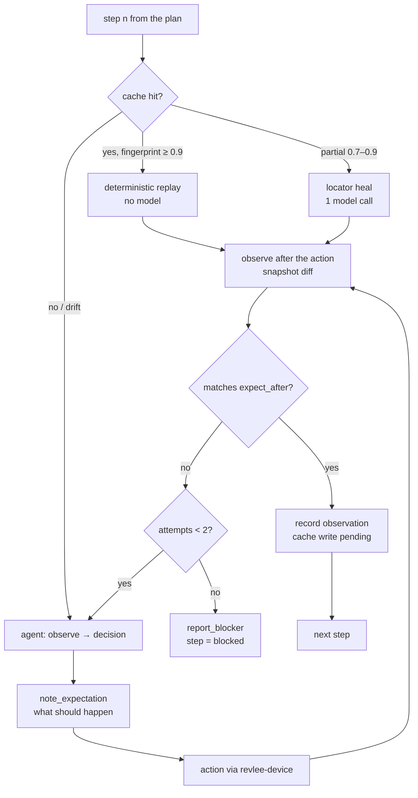

# 08 · Executor Agent, Oracles, and Judge

## 1. Executor Agent

### 1.1 Role and boundaries

The Executor runs the scenarios from the plan. **It does not evaluate the result** (the oracle layer does that); it only: navigates, acts, records expectations and observations. It runs on the Claude Agent SDK with a tool set restricted to `revlee-device` (allow-list `mcp__revlee_device__*`) plus two tools of its own: `note_expectation` and `report_blocker`. No `Bash`, `Edit`, `Write`, no GitHub.

### 1.2 Step loop



Rules:
- **Expectation before action** (`note_expectation`) is mandatory and goes into `actions.ndjson`; comparing the expectation with the observation after the action is a signal for the judge, but **not a verdict**.
- **A11y-first perception.** A screenshot is attached to the model context only when: the snapshot has few interactive elements (< 3) or a `canvas/WebView/Image` was detected as the only element, the scenario has `vision: required`, or the agent explicitly requests it (`with_screenshot: 'always'`) — every request counts toward the vision budget (`budget.max_screenshots_to_model`).
- **Visual grounding** (tap by coordinates) is allowed only after a failed tap by ref/selector; optionally via a local grounding model (`models.grounding`, e.g. UI-TARS-1.5-7B via vLLM), in which case the large model does not see the screenshot at all.
- **Loop detection:** 3 consecutive identical fingerprints after mutating actions → the model is instructed to change its approach; 5 → the step becomes `blocked`.
- **One recovery per scenario** (Momentic pattern): after one successful repair, further errors end the scenario as `blocked`, so that errors do not accumulate.
- **Model context:** a sliding window of the last 6 observations + a summary of the earlier ones; images older than 3 steps are removed from the context (server-side tool-result clearing in the Agent SDK); prompt caching for the fixed part (plan, playbook).

### 1.3 Recording observations

Every step → `observation`:
```json
{ "scenario": "S1", "step": 3, "ts": "…", "source": "agent|replay|heal",
  "expectation": "a toast 'Added: Orchid Mantis' appears",
  "action": { "tool": "tap", "target": { "ref": "@e12", "role": "button", "name": "Add to cart", "test_id": "add-to-cart" } },
  "before": { "fingerprint": "sha1:…", "snapshot_id": "obs_41" },
  "after": { "fingerprint": "sha1:…", "snapshot_id": "obs_42", "screenshot_id": "shot_17", "diff_summary": "+ [text] 'Added: Orchid Mantis' ; = 38 nodes" },
  "expectation_met_by_agent": true,
  "model_calls": 1, "tokens_in": 4120, "tokens_out": 180, "usd": 0.011 }
```
The agent's narration/reasoning is stored separately (`agent_transcript.jsonl`) and **is not an input to the judge**.

## 2. Step cache and replay

### 2.1 What and how we cache (e2e + agent-device `.ad` pattern)

- **Key:** `sha256(project, platform, scenario_id, step_n, instruction_norm, before.fingerprint_class, device_profile)`. `fingerprint_class` is the fingerprint after removing dynamic values; device profile = model + OS version + orientation + locale.
- **Value:** the action recorded as a **semantic target** (`role`, `name`, `test_id`, parent context), the typed text (secrets as a name), an end-state check (route/screen title + up to 8 elements that appeared / disappeared), **and** a generated `.ad` line (`press id="add-to-cart"`) for replay via agent-device.
- **Write:** only after the step's or scenario's deterministic oracle has passed (never on `fail`/`blocked`). Assertions and the judge are never cached (always "live").
- **Storage:** `.revlee/cache/<platform>/<scenario>.json` in the artifacts + an index in the App Map database; optionally committed to the repo ("test data" mode, like e2e), in which case a PR can change the cache and the reviewer sees it.

### 2.2 Replay and invalidation

| Situation | Behavior |
|---|---|
| fingerprint ≥ 0.9 and target found | replay (0 model calls), `source: replay` |
| target not found, fingerprint 0.7–0.9 | locator heal: the model gets the snapshot and the semantic target, picks a ref; `source: heal`, cache updated on success |
| fingerprint < 0.7 or a screen from the current diff's `ImpactMap` | `stale` → agent from scratch; `source: agent` |
| OS version/device different from the key | miss (separate key) |
| `/verify again` | cache ignored (`off` mode) |
| second push on the PR | steps on screens outside the `ImpactMap` → replay; on affected ones → agent |

The report shows per step: `replayed | healed | agent | blocked`, plus the share of tokens saved.

## 3. Oracle hierarchy

| Level | Type | How it works | Can yield `pass`? |
|---|---|---|---|
| 1 | `a11y_assert` | `assert_element` on the snapshot (role/name/testID/text/value/state) | yes |
| 2 | `state_assert` | value from extraction (`extract`), logs (`read_logs` grep), network request (`network_dump`), optionally a read-only query to the test backend/sqlite (`device.state`) | yes |
| 3 | `visual_diff_vs_base` | the same step on base and PR → (a) a11y tree diff, (b) `odiff` with `ignore-regions.yaml` and a threshold; the LLM **only classifies** the difference as `intended | unintended | neutral` against the `change_intent` | yes, when the diff matches `expected_on_base` and the `intended` classification is unanimous |
| 4 | `vlm_rubric` | VLM judge with a rubric, N samples (default 3, two model families), evidence citation required | yes, only with unanimity and a citation |
| 5 | free-form judgment | "does anything look wrong?" | **no**; can only downgrade to `inconclusive` or add a `finding` |

Principle: **the strongest available oracle wins**. If `a11y_assert` passed and the VLM judge "has doubts", the result is `pass` with a low-weight `finding`, not `inconclusive`.

## 4. Judge (LLM-as-judge) — a design resistant to false "pass"

Evidence from research (AgentRewardBench: ~70 % judge precision; Mobile-JudgeBench: "surface UI match", "partial completion"; Gaming the Judge: agent narration raises false passes by 90 %) translates into rules:

1. **Judge input** = rubric + expected result + observations (screenshots and/or a11y snapshots with labeled indices) + optionally the base/PR pair. **Never** the agent transcript, never `expectation_met_by_agent`.
2. **Structured output**: `{ verdict: pass|fail|inconclusive, evidence: [{ observation_id, element_or_bbox, why }], unmet_subcriteria: [...], notes }`. No evidence citation → the response is rejected and repeated; a second miss → `inconclusive`.
3. **Sub-criteria checklist**: the rubric is broken down into atomic points (e.g. "toast visible", "text contains the product name", "toast disappeared within ≤ 3.5 s"); the judge evaluates each separately (against "partial completion").
4. **Voting**: N = 3 independent samples (temperature > 0 or different models: e.g. 2× Claude Sonnet 5.5 + 1× GPT-5.4). `pass` only at 3/3; 2/3 → `inconclusive`; ≥ 1 `fail` with cited evidence → `fail` after verification by a 4th sample.
5. **Negative control** always evaluated by the same judge: proof that the judge is able to say "no" (base does not show the new element). A judge that gave `pass` to the negative control despite no change invalidates its votes in this run (`judge_calibration_failed`).
6. **Against "surface UI match"**: for `behavior` criteria the judge receives a **sequence** (before → action → after), not a single screen.
7. **Confidence** is computed, not declared: `confidence = w_oracle × agreement × evidence_quality`, where `w_oracle` ∈ {1.0 a11y, 0.95 state, 0.85 visual_diff, 0.7 vlm}, `agreement` = share of agreeing votes, `evidence_quality` lowered for `PIXEL_TAINTED`, missing base, truncated diff.

Judge prompt (abridged):
```
You are an independent QA judge. You evaluate ONLY the attached observations.
Criterion: {rubric}. Expected result: {expected}. Change context: {change_intent}.
For each sub-criterion provide: verdict, observation_id, element/bbox, a one-sentence justification.
If the observations are insufficient, answer "inconclusive" and say what evidence is missing.
Do not assume the action succeeded just because the order of observations would suggest it.
```

## 5. Differential comparison base vs PR

```mermaid
sequenceDiagram
  participant O as Orchestrator
  participant D as Device
  participant X as Executor
  participant J as Judge
  O->>D: install PR build
  X->>D: scenario S (agent/replay) → observations_PR
  O->>D: reset + install base build (same device profile, same network mocks)
  X->>D: scenario S (replay from the PR cache; heal when needed) → observations_base
  O->>O: for each oracle with expected_on_base: a11y diff + odiff(PR, base)
  O->>J: diffs + change_intent → intended/unintended classification
  J-->>O: per difference: intended | unintended | neutral + citation
```

- **Intended** differences confirm the criteria (`expected_on_base: different/absent`).
- **Unintended** differences on smoke screens → a `finding` of weight `issue` (run verdict ≤ `ready_with_issues`).
- No difference where one was expected (`expected_on_base: different`, but odiff = 0 %) → the criterion `fail`s ("the change is not visible").
- `ignore-regions.yaml` (status bar, clocks, avatars, ads) + a11y normalization limit the noise; odiff threshold defaults to 0.1 % of pixels with `antialiasing: true`.
- When the base build is unavailable → level 3 oracles degrade to level 4, and the report says "no comparison with base".

## 6. Figma as an auxiliary oracle (optional)

When the ticket/configuration points to a Figma frame for a screen: PNG export at device scale → region matching (status bar/tab bar mask) → odiff + SSIM → a `fidelity_score` result and a heatmap as a `finding` of type `polish`. It never decides a `fail` (mockups differ from the implementation by design), unless the AC explicitly say "pixel-perfect".

## 7. Failure classification (triage)

Every `fail`/`blocked` gets a cause label (Revyl triage skill pattern):

| Label | Signals | Effect |
|---|---|---|
| `real_bug` | deterministic oracle failed, end state contradicts the AC, crash in the logs | criterion `fail` |
| `test_setup` | login/onboarding/permissions screen blocks the start; auth bypass did not work | `unable_to_verify(setup)` + a hint in the report |
| `infra` | device did not come up, missing build, boot timeout | `unable_to_verify(infra)` |
| `flaky` | the same step passed after one retry without a state change; differences only in dynamic regions | `pass` with a `flaky_step` annotation |
| `plan_error` | the step refers to a screen/element that does not exist in any build | `inconclusive` + a finding for the Planner (it learns through the previous plan) |
| `budget` | turns/cost/time exceeded | `inconclusive(budget_exhausted)` |

Distinguishing "element missing in PR, but present in base" (probably a regression) from "missing in both" (plan_error) is possible only thanks to the differential comparison, which is why it is enabled by default.

## 8. Criterion verdict schema

```json
{
  "criterion_id": "AC2",
  "verdict": "pass",
  "oracle_type": "a11y_assert",
  "confidence": 0.96,
  "evidence": [
    { "observation_id": "obs_42", "kind": "a11y", "detail": "[text] 'Added: Orchid Mantis' present", "screenshot_id": "shot_17" },
    { "observation_id": "obs_44", "kind": "a11y", "detail": "no node contains 'Added:' after 3.5s" }
  ],
  "negative_control": { "id": "N1", "result": "pass", "detail": "base: no toast after tap (obs_base_12)" },
  "judge_votes": null,
  "base_comparison": { "performed": true, "intended_diffs": 1, "unintended_diffs": 0 },
  "step_sources": { "replayed": 1, "healed": 0, "agent": 3 },
  "triage": null,
  "cost_usd": 0.42
}
```
